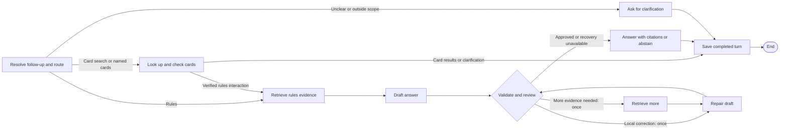
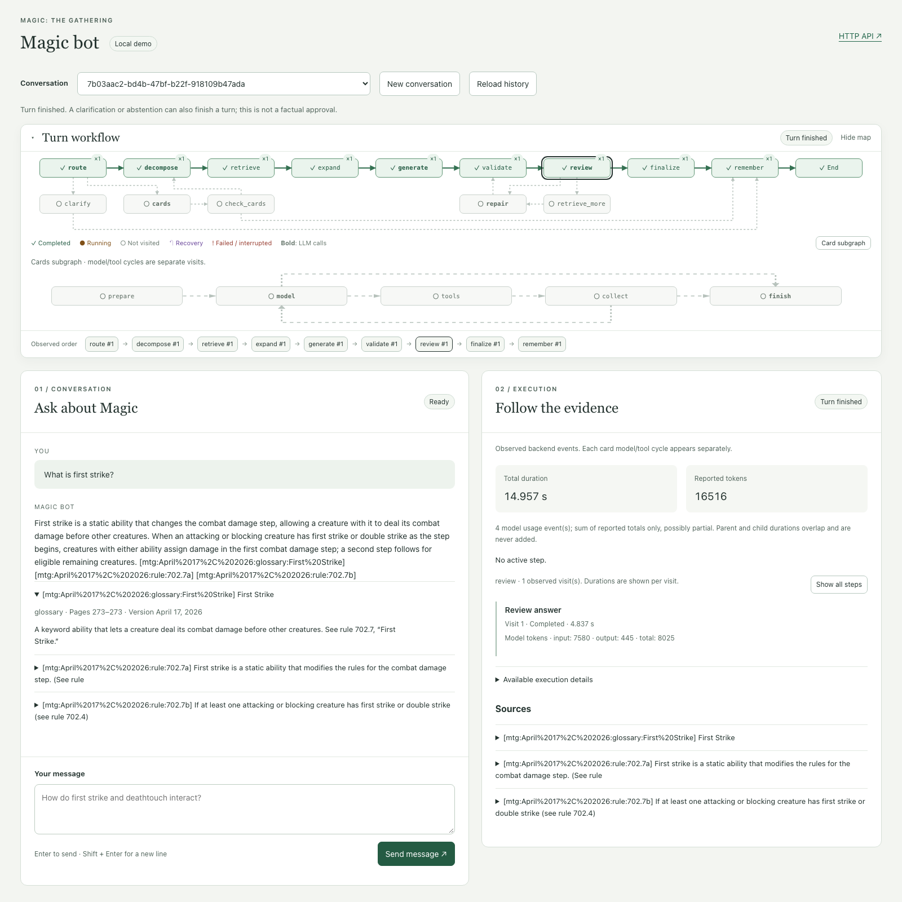
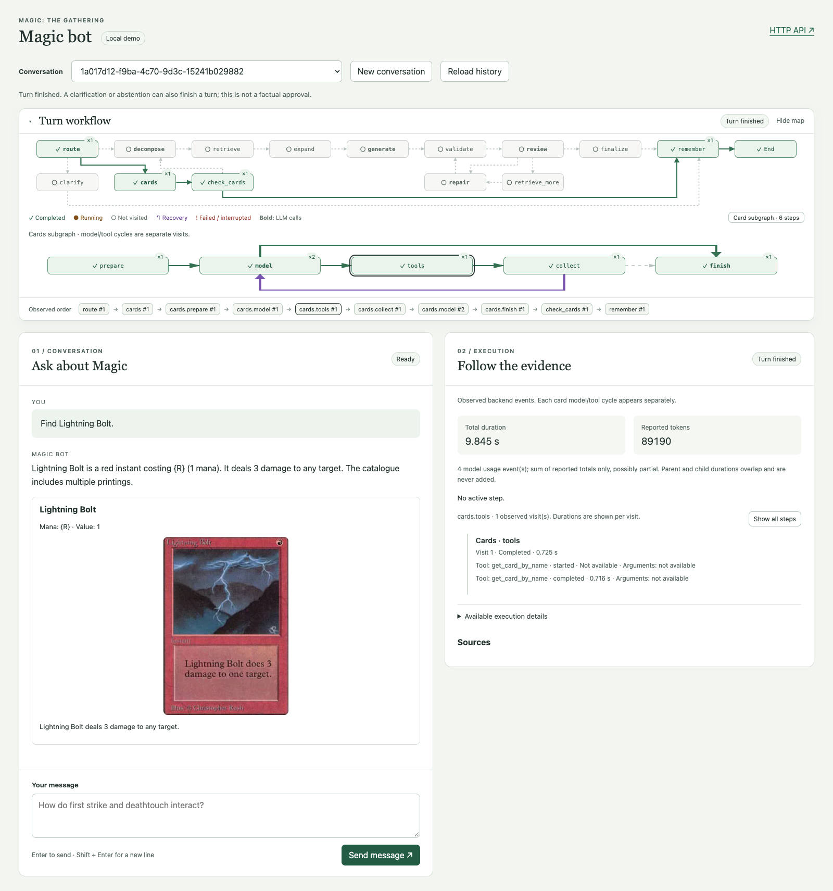

# Magic Bot

A local **Magic: The Gathering** assistant that answers rules questions in English
and Spanish, searches live cards, and supports conversational follow-ups. It combines
retrieval-augmented generation (RAG), native LangChain tools, and LangGraph workflows
with citation validation and bounded answer review.

The application includes a Python/FastAPI backend and a plain HTML/CSS/JavaScript
frontend. The chat shows answers, source excerpts and card records; a separate
execution panel shows observed graph steps, durations and reported token usage.

## Documentation

- [Usage](docs/usage.md): run the demo, configure it and verify behavior.
- [Architecture](docs/architecture.md): system boundaries, graphs and design decisions; links to component references.
- [Evaluation](docs/evaluation.md): measured results, evidence and limitations.

Detailed component guides live under `docs/reference/`; supporting measurements
live under `docs/experiments/`. Local development notes in `docs/internal/` are
excluded from delivery.

## Prerequisites

- Git and network access to the model provider and card catalogue.
- For local Python execution: **uv and Python 3.12**. uv manages `.venv` and the
  dependencies pinned in `uv.lock`; no manual virtualenv activation is needed.
- For container execution: **Docker Engine with Compose v2**, or Docker Desktop
  with Compose included. Host Python and uv are unnecessary for this path.
- An `OPENAI_API_KEY` for model calls and uncached embeddings. Langfuse is optional.

Model calls and uncached embeddings use paid APIs. Direct catalogue CLI requests
use the external catalogue without an LLM. The frontend needs no Node/npm build.

## Clone and configure

```sh
git clone https://github.com/javicupeiro/magic-bot.git
cd magic-bot

# Create .env only if it does not already exist.
if [ ! -f .env ]; then cp .env.example .env; fi
```

Edit `.env` and replace the `OPENAI_API_KEY` placeholder. Keep credentials on the
backend. [.env.example](.env.example) lists model, embedding and optional tracing
settings; existing process environment variables take precedence over `.env`.

The source PDF is included at `data/game_rules/MagicCompRules_20260417.pdf`.
Run the commands below from the repository root so relative data paths resolve.

## How the agent works

The rules PDF is prepared ahead of time: structured rules, glossary entries and
resolved references are stored in Chroma with embeddings. At runtime, the agent
retrieves this evidence for rules questions and uses the live
magicthegathering.io catalogue for card searches and named-card interactions.

This simplified view follows the execution map in the UI. Retrieval groups query
decomposition, rules/glossary search and reference expansion; validation and review
combine Python citation checks with a model assessment of support and completeness.



Each message loads recent complete turns to interpret follow-ups such as “and
only the ones that cost one?”. The router produces a self-contained English query
and keeps the user's reply language. History helps interpret the question; every
turn gathers fresh evidence.

The route determines what the user receives:

- **Card search:** the card subgraph selects catalogue tools within fixed call and
  pagination limits, then returns card records and a summary. This path ends
  without rules retrieval; a search can also report no matches or incomplete
  catalogue results.
- **Rules question:** the agent retrieves rules and glossary entries, follows
  resolved references and drafts an answer. Python checks source IDs and builds
  citations from stored records; the model reviews evidence support and completeness.
  An approved draft becomes the answer with citations.
- **Rules interaction with named cards:** catalogue lookups run first. Rules
  retrieval starts only after every named card has an exact verified identity and
  card text. Missing or ambiguous identities request clarification; card evidence
  exceeding the context budget asks the user to narrow the interaction.
- **Unclear or outside scope:** the router returns a clarification or scope response
  instead of running tools or rules retrieval.
- **Insufficient support:** a rejected rules draft may use one additional retrieval
  round followed by one repair, or a local repair using existing evidence. The
  repaired draft is validated and reviewed again and cannot reopen recovery. If
  approval is still unavailable, the agent abstains instead of publishing the draft.

All completed paths save the user/assistant pair in SQLite for later follow-ups.
Execution failures or disconnects are handled separately: the UI reports the
interruption, and completed history can be reloaded before deciding to resend.
FastAPI streams execution events and the terminal result from this same workflow;
optional Langfuse tracing observes the execution through callbacks.

See [Architecture](docs/architecture.md) for the full
[question graph](docs/architecture.md#answering-one-question),
[card-tool cycle](docs/architecture.md#native-tool-cycle), evidence budgets and
[HTTP/UI lifecycle](docs/architecture.md#application-boundaries).

## UI preview

Ask in English or Spanish, read the answer in the chat, and follow the observed
steps in the execution panel. The map highlights the path taken for each turn;
select a node to inspect its visits, durations and reported token usage.

**Rules questions with sources.** This example asks “What is first strike?” and
shows the answer with citations and an expanded source excerpt.



**Card lookup with tool execution.** Searching for Lightning Bolt returns its
image, mana cost and card text. The expanded card subgraph shows the model/tool
cycle; selecting the tools node displays the catalogue lookup in the right panel.



These examples show completed live turns. Answers, timings, token usage and card
images can vary between runs. Use **New conversation** to start a fresh chat or
continue asking follow-up questions in the same conversation.

## Open and close the UI

After completing the configuration and ingestion steps below, run these commands
from the repository root. Both options serve the same application; uv uses local
data and Docker uses separate persistent volumes.

### With uv — port 8000

```sh
# Start the API and UI in the foreground.
uv run --locked uvicorn backend.api.app:app --host 127.0.0.1 --port 8000 --workers 1
```

Open **http://127.0.0.1:8000/ui/**. To stop it, press **Ctrl+C in the terminal
running that command**. To restart with code changes, stop it and run the same
command again.

### With Docker — port 8015

```sh
# Build the current code and start the API and UI in the background.
MAGIC_BOT_PORT=8015 docker compose up -d --build --wait

# Stop and remove containers; keep the index and conversation volumes.
docker compose down

# Restart with all code changes.
MAGIC_BOT_PORT=8015 docker compose up -d --build --wait
```

Open **http://127.0.0.1:8015/ui/**. Closing a browser tab does not stop either
server, and `docker compose down` does not stop the local uv server. After an
update, reload the browser page. See the installation sections below for first use.

## Run locally with uv

Install uv using its [official installation instructions](https://docs.astral.sh/uv/getting-started/installation/).
For macOS/Linux, the standalone installer is:

```sh
curl -LsSf https://astral.sh/uv/install.sh | sh
```

Open a new terminal if needed to make `uv` available, then install Python and
synchronize the locked project environment:

```sh
uv --version
uv python install 3.12
uv sync --locked
```

uv's [Python installation guide](https://docs.astral.sh/uv/guides/install-python/)
explains managed interpreters. Prepare the rules index explicitly:

```sh
# PDF -> text; no model calls.
uv run --locked pdf-to-text
# Text -> rules, glossary, references and provenance JSONL.
uv run --locked parse-rules
# JSONL -> cached embeddings and persistent Chroma index.
uv run --locked ingest-rules
```

Ingestion can incur embedding charges and reuses compatible cached embeddings.
Ordinary application startup does not ingest. Card-only requests do not need the
rules index, but rules questions do.

Start the API and frontend:

```sh
uv run --locked uvicorn backend.api.app:app --host 127.0.0.1 --port 8000 --workers 1
```

- **Web chat:** http://127.0.0.1:8000/ui/
- **Interactive API documentation:** http://127.0.0.1:8000/docs
- **OpenAPI schema:** http://127.0.0.1:8000/openapi.json
- **HTTP health:** http://127.0.0.1:8000/health

FastAPI serves `frontend/` from the same origin. Use **New conversation** to start
an isolated chat and the selector to reload completed history. The execution panel
shows the latest turn's events; it does not replay historical execution details.
Stop the local server with Ctrl+C. Use one worker: conversation exclusion is
process-local and SQLite is the persistence backend.

## Run with Docker

Install and start Docker using the [Compose installation guide](https://docs.docker.com/compose/install/).
After cloning and configuring `.env`, verify the runtime and build:

```sh
docker --version
docker compose version
docker compose build

# Prepare the container's own persistent index.
docker compose run --rm app pdf-to-text
docker compose run --rm app parse-rules
docker compose run --rm app ingest-rules

MAGIC_BOT_PORT=8015 docker compose up -d --wait
curl --fail http://127.0.0.1:8015/health
```

Open **http://127.0.0.1:8015/ui/**; API documentation is at
http://127.0.0.1:8015/docs. The image installs the locked Python
environment and runs as a non-root user. Compose mounts the source PDF directory
read-only and maintains three named volumes: `processed`, `chroma` and
`conversations`. These are independent of host-side indexes and conversation data.

```sh
docker compose ps
docker compose logs --tail=100 app
docker compose run --rm app magic-chat 'What is first strike?'
docker compose run --rm app magic-chat --help

# Stop and remove containers while retaining named volumes.
docker compose down
# Rebuild and recreate the service with the same knowledge and conversation data.
MAGIC_BOT_PORT=8015 docker compose up -d --build --wait
```

The commands above explicitly use port 8015 so Docker can run alongside uv on
8000. Without `MAGIC_BOT_PORT`, Compose defaults to port 8000.
`docker compose down -v` also deletes the
knowledge and conversation volumes; use it only for an intentional data reset.
See [Docker and persistence](docs/usage.md#docker-clean-delivery-and-persistent-data)
for the complete verification procedure.

## Test the HTTP API

With the uv server running on port 8000, inspect the application without model
calls. For the Docker commands above, replace port 8000 with 8015 in these URLs:

```sh
curl -sS http://127.0.0.1:8000/health
curl -sS http://127.0.0.1:8000/version
curl -sS http://127.0.0.1:8000/conversations
```

Create a conversation, then replace the placeholder with the returned UUID:

```sh
curl -sS -X POST http://127.0.0.1:8000/conversations
CONVERSATION_ID='<returned UUID>'

# Stream actual execution events and the terminal answer from this POST.
curl -N -H 'Content-Type: application/json' \
  -d '{"message":"What is first strike?"}' \
  "http://127.0.0.1:8000/conversations/$CONVERSATION_ID/messages"

# Retrieve completed user/assistant messages, including after server restart.
curl -sS "http://127.0.0.1:8000/conversations/$CONVERSATION_ID/messages"
```

Reuse the UUID for follow-ups. These turns call real providers. SSE reports steps,
usage, sources and a final answer; it does not stream answer tokens. A concurrent
turn on the same conversation returns HTTP 409. Avoid automatically retrying a
message POST after disconnection: the turn may already have been saved and there
is no idempotency key. [HTTP API](docs/reference/http-api.md) specifies schemas and errors.

## CLI commands

The full agent also runs without the web server:

```sh
uv run --locked magic-chat 'What is first strike?'
uv run --locked magic-chat 'Find Lightning Bolt' --json
uv run --locked magic-chat 'Can I use ninjutsu after first-strike damage?' --events

# Persist and resume a conversation between CLI processes.
uv run --locked magic-chat 'Find green Elf creatures.' --conversation-id elves
uv run --locked magic-chat 'And only ones with mana value one?' --conversation-id elves
```

Omitting `--conversation-id` starts a new conversation. CLI IDs are not automatically
registered in the HTTP conversation selector. `--json` exposes internal diagnostic
state; `--events` emits completed node names during one execution and does not print
the final answer. Normal output includes the answer, conversation ID and citations.

Inspect individual layers when debugging:

```sh
# Semantic retrieval and exact rule lookup, without answer generation.
uv run --locked search-rules 'first strike' -k 5
uv run --locked search-rules --rule 702.7b
# Simple rules-answer baseline without the full graph's review cycle.
uv run --locked answer-rules 'What is first strike?'
# Native card-agent graph only.
uv run --locked card-chat 'Find Lightning Bolt' --trace
# Direct catalogue access without a model.
uv run --locked card-catalogue name 'Lightning Bolt'
uv run --locked card-catalogue search --color G --subtype Elf --cmc '<2'
# Measure retrieval against the saved question bank; uses query embeddings.
uv run --locked benchmark-retrieval --method both --output data/retrieval/local-comparison.json
```

All entry points support `--help`. The full workflow accepts `--method vector|hybrid`,
`-k`, `--context-budget`, `--history-budget`, `--max-calls`, `--max-pages` and
`--memory-db`. Defaults are 20 retrieval hits per query and kind, 24,000 evidence
characters, 8,000 history characters, four card-tool requests and three HTTP pages
per lookup. Character budgets are not token budgets. See the [command guide](docs/usage.md).

## Tests and evaluation

Run deterministic tests without paid model or catalogue calls:

```sh
LANGFUSE_TRACING_ENABLED=false uv run --locked python -m unittest discover -s tests -v
```

Tests use temporary storage and simulated provider responses. The
[delivery evaluation](docs/evaluation.md) records a separate live run of
20 scored cases, measured usage, quality findings and Docker persistence checks.
To run a fresh evaluation with real APIs and a new output filename:

```sh
LANGFUSE_TRACING_ENABLED=false uv run --locked python -m evals.delivery \
  --cases data/delivery/cases.json \
  --output data/delivery/new-run.json --workers 3
```

This incurs provider costs and refuses to overwrite an existing report. A completed
execution or valid citation does not by itself establish a correct rules answer.

## Project layout and limitations

- `backend/ingestion/`, `backend/retrieval/`: document preparation and retrieval.
- `backend/cards/`: typed catalogue client, tools and native card subgraph.
- `backend/generation/`, `backend/workflow/`: structured answers and conversation graph.
- `backend/prompts/`, `backend/common/`: versioned prompts, loading and tracing.
- `backend/api/`, `frontend/`: HTTP/SSE contract and browser UI.
- `tests/`, `evals/`, `data/`: deterministic tests, quality measurements and source/results data.

This is a local demo without authentication or distributed conversation locks.
Generation and review use the same model, so review can repeat the original error.
Evidence is bounded and may omit necessary rules. The final delivery trace was
exported, but its visual inspection remains pending authorized Langfuse access.
Production deployment, pgvector, human escalation and custom cards are proposals.
