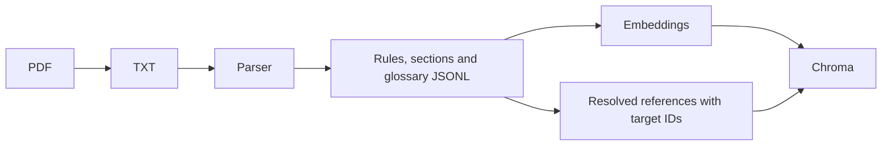
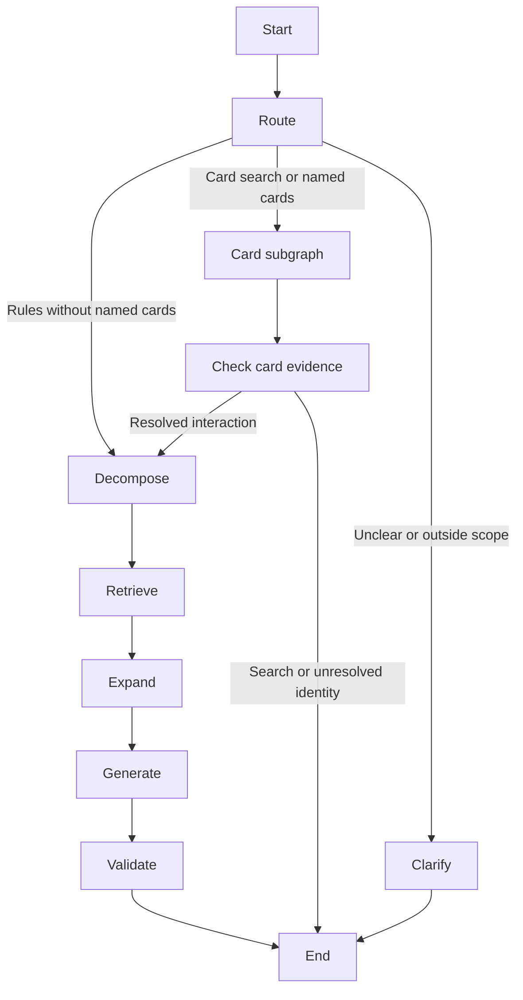
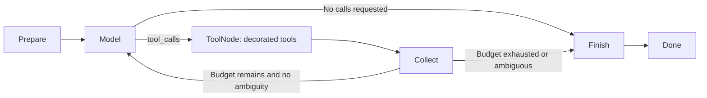

# Architecture

The project separates data access, model generation and orchestration. The HTTP
client does not know about an LLM; tools expose selected client operations to a
model; LangGraph decides when those operations run.

## Code map

- `backend/ingestion/`: PDF extraction, structured documents, embeddings and ingestion.
- `backend/retrieval/`: vector/hybrid ranking and exact document lookup in Chroma.
- `backend/generation/`: a shared LangChain model wrapper and grounded answer contracts.
- `backend/cards/mtg_api.py`: live HTTP, bounded pagination and errors.
- `backend/cards/filters.py`: remote parameters and local comparison semantics.
- `backend/cards/tools.py`: the two `@tool` functions and their argument schemas.
- `backend/cards/agent.py`: the native card-tool subgraph, also used by `card-chat`.
- `backend/cards/replies.py`: structured card reply and evidence records.
- `backend/workflow/`: routing, rule nodes, context expansion and CLI.
- `backend/common/prompts.py`: the reusable loader and active prompt versions.
- `backend/prompts/`: versioned Markdown instructions for all model steps.
- `tests/`: deterministic behavior checks; `evals/`: retrieval quality measurements.

The future UI will live in `frontend/`, separate from `backend/`. It does not exist
yet. We keep the current functional packages rather than introducing a second
`src/` hierarchy only to match the original plan.

## Preparing knowledge

`Document` is the ingestion contract. Chroma retains original text and metadata;
`SearchResult` carries that evidence back out, including parsed references.
Optional hybrid search also builds BM25 in memory from the matching JSONL,
verifies its source hashes against Chroma, and fuses vector/lexical ranks with RRF.
Vector remains the measured default; the same Retriever contract serves both
modes. See the [data flow and real comparison](ingestion-and-retrieval.md#hybrid-retrieval-and-the-measured-default).
Expansion uses these target IDs directly. It does not reinterpret references
with another regular expression at query time. Unresolved links remain available
for inspection but are not followed.

## Answering one question

`WorkflowState` is the data shared between nodes. A node returns only updated
fields. `RouteDecision` and `Decomposition` validate model outputs. The original
question stays separate from the English retrieval query.

The rules branch uses at most three queries, searches rules and glossary
separately, deduplicates results and follows one hop of resolved references.
At most six extra documents can be added. Complete sources share a serialized
character budget with verified cards; this is not a token budget.

`Generate` produces claims with source IDs. `finish_answer()` is shared by this
graph and the simpler `answer-rules` baseline: it validates IDs, constructs
citations from stored records and renders the answer or abstention. It cannot
prove that an interpretation is correct. Answer review remains future work.

## Native tool cycle

1. `prepare` loads the active card prompt and the user question. For an interaction,
   it also loads the separate name-resolution prompt.
2. `model` invokes the model with the decorated tools bound to it. Its `AIMessage`
   contains requested names, arguments and call IDs. This node checks the budget
   and rejects duplicate/missing IDs before any tool runs.
3. `tools` is an actual `ToolNode`. It validates argument schemas and executes the
   matching `@tool` function. The function calls `MtgApiClient`; domain validation
   occurs before HTTP. Results arrive as native `ToolMessage` objects.
4. `collect` retains exchanges and source records for inspection. Rejected calls
   consume budget too. Ambiguous exact matches stop further lookups.
5. `finish` makes one separate structured model call with the catalogue evidence
   and no tools. It checks declared card names against complete successful results.

The final formatting call adds latency and tokens; it is an explicit step rather
than hidden inside tool execution. We retain it for predictable output. For a
rules interaction, the subsequent check additionally requires complete exact
lookups for every original name and actual card text. Corrections that do not
establish that mapping require clarification.

The HTTP client is captured in the tools' factory closure, so the model cannot
choose the URL, page limit or retry settings. `@tool` publishes a schema; it does
not make arguments trustworthy or replace the HTTP client.

There is one cycle. The former manual Responses dispatcher and the
`CatalogueToolNode` conversion bridge have been removed. `ChatOpenAI` handles the
provider protocol; application code uses LangChain messages throughout. The same
LLM wrapper handles structured generation, preparing later callback integration.

## Observability now and later

`QuestionWorkflow.stream()` delegates to LangGraph with `stream_mode="updates"`
and `subgraphs=True`. Child events include a namespace, so consumers can see
`cards/model`, `cards/tools`, `cards/collect` and `cards/finish` separately.
`magic-chat --events` prints only namespaces and completed node names.

Native model messages retain usage metadata when the provider reports it. Raw
state is internal diagnostic data and can contain provider metadata. The future
HTTP adapter must expose an allowlisted event schema, not dump those messages to
the browser. No internal reasoning or encrypted provider state belongs in the UI.

Future work may add callbacks, safe HTTP events and the panel. They must distinguish
the parent cards span from its children when aggregating tokens and duration.
There are currently no persistent sessions, token dashboard or Langfuse traces.

## Limits and tradeoffs

- Complete catalogue evidence is checked structurally; free-form prose still relies on the model.
- The rules context limit counts characters, not the complete request's tokens.
- `answer-rules` remains a deliberately simple baseline for comparison. It shares the model, prompts and final validation policy with the main workflow.
- Exact lookups need no embeddings. Semantic queries still embed each query per search call; batching/caching is not part of this cleanup.
- A new graph and HTTP client are created for each independent question. Persistent conversations are planned for a later iteration.

References: [LangGraph workflows](https://docs.langchain.com/oss/python/langgraph/workflows-agents),
[ChatOpenAI integration](https://docs.langchain.com/oss/python/integrations/chat/openai).

The [retrieval parameter sweep](retrieval-parameter-sweep.md) measures result counts and candidate budgets without changing graph nodes or parsing boundaries. It records retrieval coverage and raw context costs separately from generated-answer quality.
