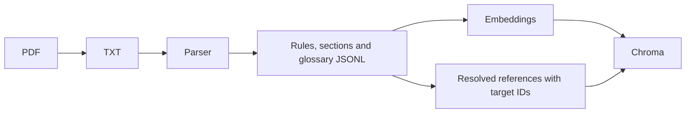
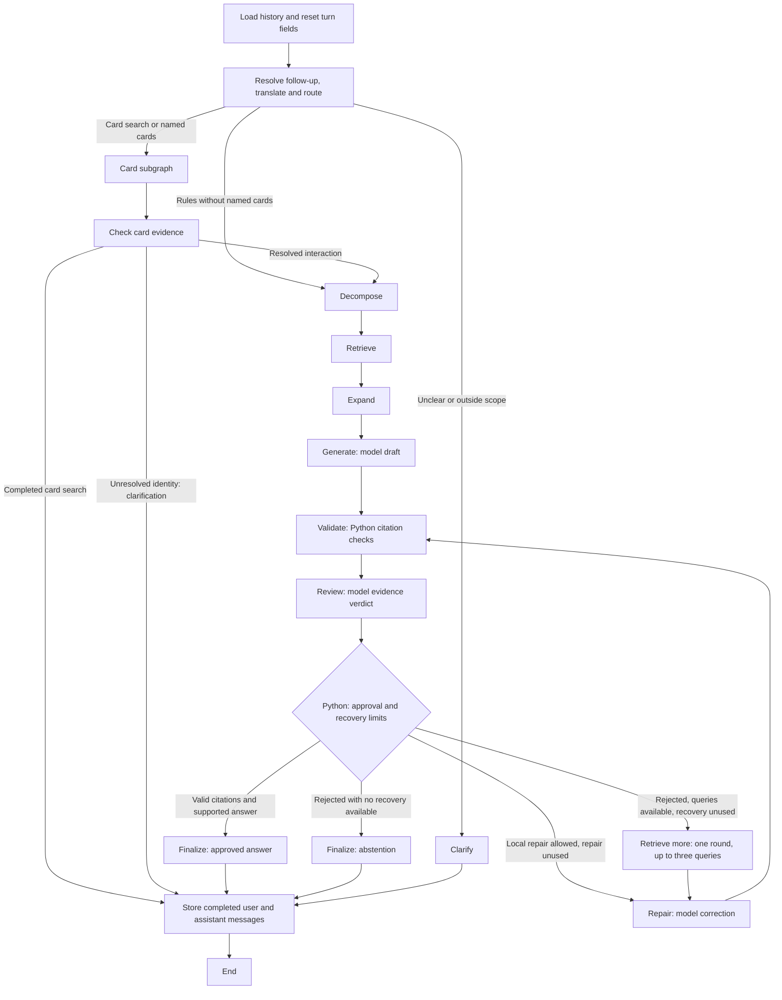
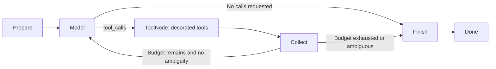
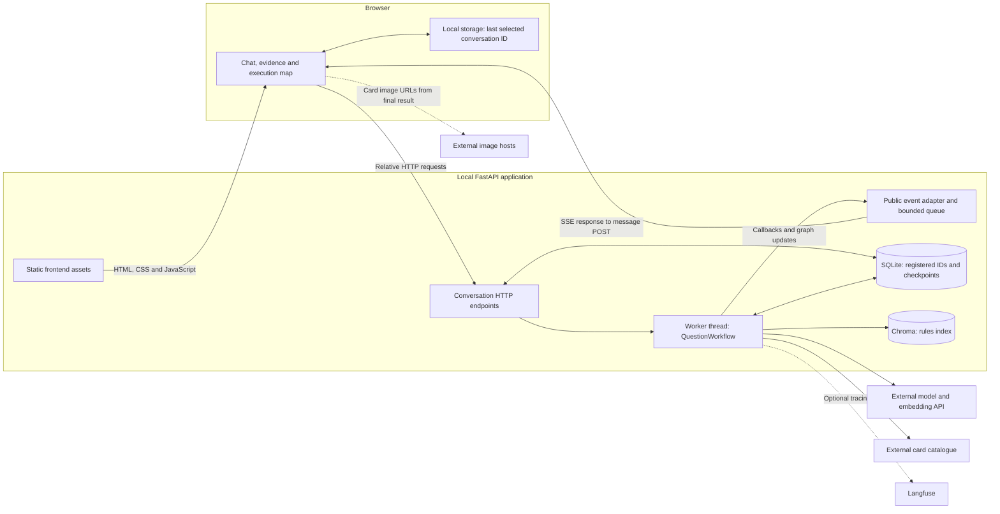

# Architecture

The project separates data access, model generation and orchestration. The HTTP
client does not know about an LLM; tools expose selected client operations to a
model; LangGraph decides when those operations run.

## Preparing knowledge

`Document` is the ingestion contract. Chroma retains original text and metadata;
`SearchResult` carries that evidence back out, including parsed references.
Optional hybrid search also builds BM25 in memory from the matching JSONL,
verifies its source hashes against Chroma, and fuses vector/lexical ranks with RRF.
Vector remains the measured default; the same Retriever contract serves both
modes. See the [data flow and real comparison](reference/ingestion-and-retrieval.md#hybrid-retrieval-and-the-measured-default).
Expansion uses these target IDs directly. It does not reinterpret references
with another regular expression at query time. Unresolved links remain available
for inspection but are not followed.

## Answering one question

`WorkflowState` is the data shared between nodes. A node returns only updated
fields. `RouteDecision` and `Decomposition` validate model outputs. The original
question stays separate from the English retrieval query.

The rules branch uses at most three queries, searches rules and glossary
separately, deduplicates results and follows one hop of resolved references.
At most six extra documents can be added. The current balanced policy interleaves
initial hits by query/kind and initially reserves 20% of rules space for expansion.
Complete sources share a serialized character budget with compact verified-card
evidence; this is not a token budget. Oversized card evidence blocks the interaction
before rules retrieval.

`Generate` produces claims with source IDs. `finish_answer()` is shared by this
graph and the simpler `answer-rules` baseline: it validates IDs, constructs
citations from stored records and renders the answer or abstention. It cannot
prove that an interpretation is correct.

`Review` uses the same LLM to assess the question, verified cards, bounded rules
and original proposal, including the exact citation rejection when present.
`EvidenceReview` adds an explicit action to `supported`, `unsupported_claims`,
`missing_information` and up to three `followup_queries`. Legacy v1 uses
`AnswerReview` without that action. Brief factual objections are stored in
`reviews`; no private reasoning is requested. Python only accepts a complete,
locally valid draft with an affirmative, consistent verdict.

On rejection, Python permits at most one repair. It can follow one additional
retrieval round, recorded in `additional_retrievals`, or use existing evidence
when the current policy allows local repair. Explicit abstention does not recover. Old cited sources have priority,
followed by new hits and remaining old sources, within the same character budget.
There is no additional reference expansion. Repair requests preservation of
supported parts; citation validation and a final review check the complete result.
The final verdict cannot reopen retrieval. Rejection clears final claims/citations
and renders the shared abstention.

## Conversation lifetime

`QuestionWorkflow` owns one `SqliteSaver` connection and catalogue client inside
its `with` block. It compiles once against those live dependencies and discards
the graph before closing them. `answer()` and `stream()` accept a stable
`conversation_id`, mapped directly to LangGraph's `thread_id`. Omitting it creates
a new conversation; the result (or CLI event header) exposes the generated ID.
The same ID and SQLite path recover history after a backend restart.

`memory.py` opens SQLite and defines a reference-counted per-conversation lock.
The lock spans loading, preparation and all graph execution, including streaming,
and is shared across workflow instances in one process. SQLite serializes storage
access; this local lock additionally prevents two turns from reading the same
old state and overwriting each other's conversation. Separate backend processes
need additional coordination and are outside the local runtime contract.

`messages` contains the complete completed user/assistant history. `_prepare_turn`
selects recent context, then resets every turn field: decisions, cards, native
`tool_messages`, exchanges, evidence, drafts, citations, reviews, budgets, prompt
provenance and trace. Historical checkpoints remain in SQLite for inspection;
they are never reused as current evidence. Only `remember` appends a completed
turn. Failed/interrupted turns do not append partial conversation messages; the
next invocation prepares a new turn rather than resuming an unfinished node.

`context.py` selects whole recent turns for `history` without changing `messages`.
Tool-call/result groups remain atomic if native tool messages are ever supplied
for selection. The mandatory current question counts toward the history limit;
an oversized question raises an error. `route/v2` resolves references using this
bounded history before translation/classification. Its self-contained English
intent is what retrieval and card tools use. Rule generation, review and repair
also receive the original question and must write user-facing claims in the
reply language. Previous answers guide interpretation, never evidence.
See [conversation memory](reference/conversation-memory.md) for budgets and examples.

## Native tool cycle

1. `prepare` loads the active card prompt and the user question. For an interaction,
   it also loads the separate name-resolution prompt.
2. `model` invokes the model with the decorated tools bound to it. Its `AIMessage`
   contains requested names, arguments and call IDs. This node checks the budget
   and rejects duplicate/missing IDs before any tool runs.
3. `tools` is an actual `ToolNode`. It validates argument schemas and executes the
   matching `@tool` function. The function calls `MtgApiClient`; domain validation
   occurs before HTTP. Results arrive as native `ToolMessage` objects.
4. `collect` retains exchanges and source records for inspection. Rejected calls
   consume budget too. Ambiguous exact matches stop further lookups.
5. `finish` makes one separate structured model call with the catalogue evidence
   and no tools. It checks declared card names against complete successful results.

The final formatting call adds latency and tokens; it is an explicit step rather
than hidden inside tool execution. We retain it for predictable output. For a
rules interaction, the subsequent check additionally requires complete exact
lookups for every original name and actual card text. Corrections that do not
establish that mapping require clarification.

The HTTP client is captured in the tools' factory closure, so the model cannot
choose the URL, page limit or retry settings. `@tool` publishes a schema; it does
not make arguments trustworthy or replace the HTTP client.

There is one cycle. The former manual Responses dispatcher and the
`CatalogueToolNode` conversion bridge have been removed. `ChatOpenAI` handles the
provider protocol; application code uses LangChain messages throughout. The same
LLM wrapper handles structured generation. Graph entry points pass callbacks
into that model.

## Observability

`QuestionWorkflow.stream()` delegates to LangGraph with `stream_mode="updates"`
and `subgraphs=True`. Child events include a namespace, so consumers can see
`cards/model`, `cards/tools`, `cards/collect` and `cards/finish` separately.
`magic-chat --events` prints only namespaces and completed node names.

Optional Langfuse tracing uses those same callbacks: one session per
conversation and one trace per turn. Generation observations carry token usage
when the provider reports it. The parent card span does not, so nested spans
are not added twice. See [observability](reference/observability.md) for configuration,
the data sent to Langfuse, and how to inspect a trace.

Native model messages retain usage metadata when the provider reports it. Raw
state is internal diagnostic data and can contain provider metadata. The HTTP adapter exposes an allowlisted event schema, never those raw messages
to the browser. No internal reasoning or encrypted provider state belongs in the UI.
Local SQLite conversations remain the chat record. The UI shows reported per-call
usage and a possibly partial turn total, not a persisted token dashboard.

## Code map

- `backend/ingestion/`: PDF extraction, structured documents, embeddings and ingestion.
- `backend/retrieval/`: vector/hybrid ranking and exact document lookup in Chroma.
- `backend/generation/`: a shared LangChain model wrapper and grounded answer contracts.
- `backend/cards/mtg_api.py`: live HTTP, bounded pagination and errors.
- `backend/cards/filters.py`: remote parameters and local comparison semantics.
- `backend/cards/tools.py`: the two `@tool` functions and their argument schemas.
- `backend/cards/agent.py`: the native card-tool subgraph, also used by `card-chat`.
- `backend/cards/replies.py`: structured card reply and evidence records.
- `backend/workflow/`: routing, rule nodes, persistent conversations, context selection and CLI.
- `backend/api/`: local FastAPI routes, public schemas and native-event-to-SSE adaptation.
- `frontend/`: browser HTML/CSS, chat state/rendering and incremental HTTP/SSE consumption.
- `backend/common/prompts.py`: the reusable loader and active prompt versions.
- `backend/common/tracing.py`: optional Langfuse session, trace and retrieval spans.
- `backend/prompts/`: versioned Markdown instructions for all model steps.
- `tests/`: deterministic behavior checks.

## Application boundaries

The browser is a client of the local FastAPI application. FastAPI serves both the
static frontend at `/ui/` and the conversation endpoints at `/conversations`.
They share a scheme, host and port, so the UI uses relative URLs and requires
neither a separate frontend server nor a permissive cross-origin policy.
Uvicorn runs the application; no JavaScript build service is involved.

The browser never calls the model or catalogue API directly. Credentials, prompts,
retrieval configuration and graph policy remain on the backend. There is one
presentation exception: a returned card's safe HTTP(S) image URL can be loaded by
the browser, with a no-referrer policy and a text fallback if it fails.

This architecture has three different kinds of state. SQLite is the durable source
of conversation IDs and completed messages. The worker owns transient graph state
and fresh evidence for a running turn. The browser keeps presentation state,
pending messages and the current execution display in memory; local storage keeps
only the last selected conversation ID, not the conversation database.

See [HTTP and UI lifecycle](reference/application-lifecycle.md) for request sequences, SSE
framing, worker ownership, concurrency, disconnects and recovery. The
[HTTP API](reference/http-api.md) defines the public schemas and error vocabulary.

## Limits and tradeoffs

- Complete catalogue evidence is checked structurally; free-form prose still relies on the model.
- The rules context limit counts characters, not the complete request's tokens.
- Current policy compacts verified-card records and blocks interactions that still exceed the evidence budget. Raw catalogue exchanges remain available for diagnosis; large catalogue responses can still increase card-subgraph latency and token usage.
- `answer-rules` remains a deliberately simple baseline for comparison. It shares the model, prompts and final validation policy with the main workflow.
- Exact lookups need no embeddings. Semantic queries still embed each query per search call; batching/caching is not part of this cleanup.
- A context-managed workflow reuses its compiled graph and open HTTP/SQLite resources. Standalone calls open and close them automatically; conversation continuity depends on the supplied ID.

References: [LangGraph workflows](https://docs.langchain.com/oss/python/langgraph/workflows-agents),
[ChatOpenAI integration](https://docs.langchain.com/oss/python/integrations/chat/openai).

The [retrieval parameter sweep](experiments/retrieval-parameter-sweep.md) measures result counts and candidate budgets without changing graph nodes or parsing boundaries. It records retrieval coverage and raw context costs separately from generated-answer quality.

## Delivery boundary

`Dockerfile` packages the same backend, versioned prompts and separate frontend
with the root uv project and lockfile. Compose runs a single non-root application
process, exposes it on loopback and mounts persistent processed/Chroma/conversation
volumes plus the source PDF directory read-only. Data preparation remains explicit;
no model call or ingestion is part of the image build or server startup.
`evals/delivery.py` exercises the existing workflow, reopening SQLite for follow-ups
and using shared measurement wrappers. It does not add another graph or
change runtime policy. See [the README](../README.md#run-with-docker)
for Docker commands and persistence.

The optional [Render demo](../deploy/README.md) uses `Dockerfile.render` and
`render.yaml`. That image restores a bundled rules index at build time without
provider calls. Unlike Compose, it uses ephemeral conversation storage and does
not include the parsed JSONL needed for hybrid retrieval.

## Further reading

The README links the main reading path. Use these references when inspecting a
specific component; they are not prerequisites for running the demo.

- [Ingestion and retrieval](reference/ingestion-and-retrieval.md): document contracts, indexing and ranking.
- [Live card catalogue](reference/live_card_catalogue.md): provider adapter, filters and partial results.
- [Conversation memory](reference/conversation-memory.md): persistence, context selection and budgets.
- [Prompt conventions](reference/prompts.md): active versions, loading and change discipline.
- [HTTP API](reference/http-api.md) and [application lifecycle](reference/application-lifecycle.md): contract and execution.
- [Observability](reference/observability.md): configuration, exported data and trace inspection.
- [Evaluation results](evaluation.md): saved measurements and known quality gaps.
