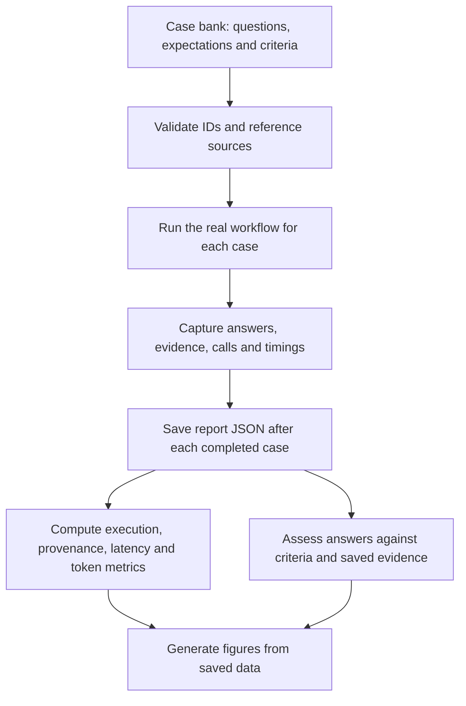
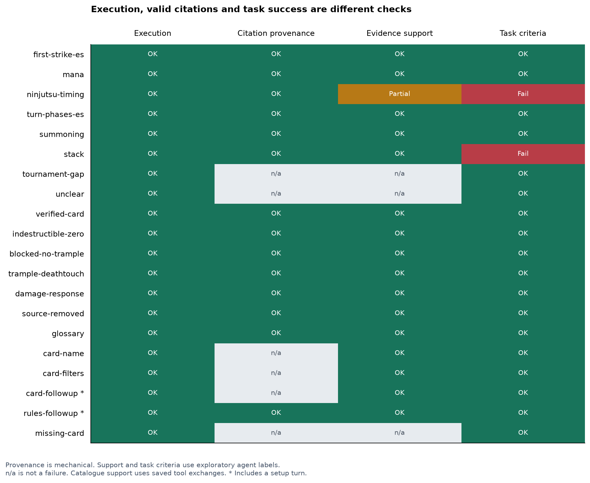
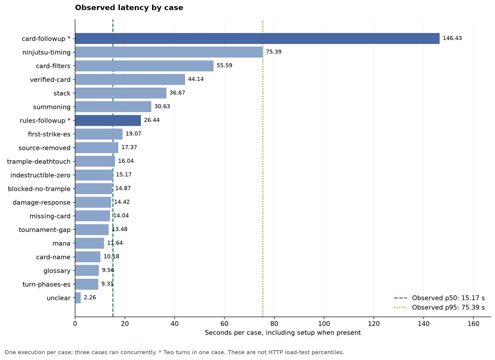
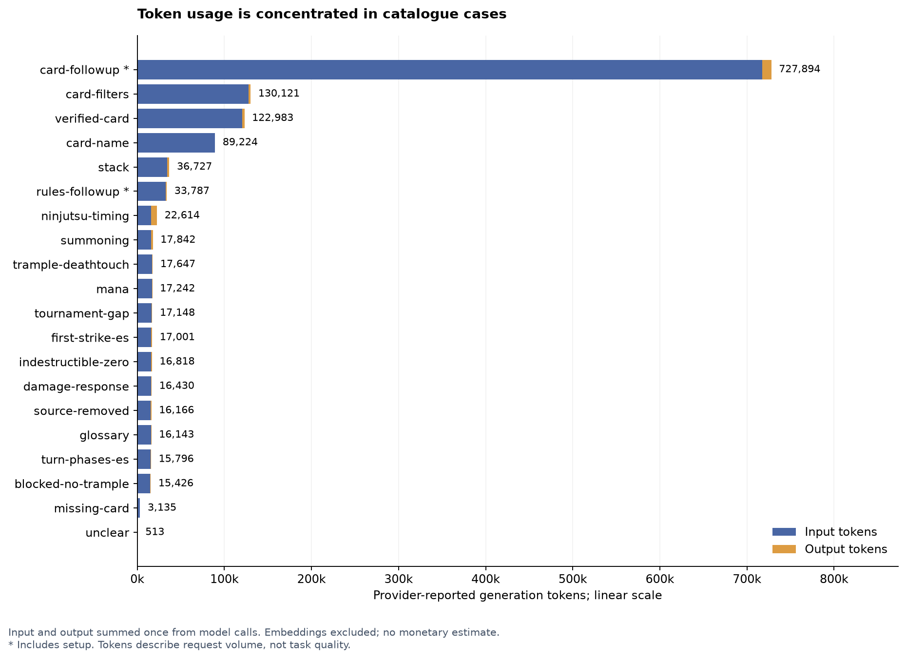

# Evaluation: cases, method and results

This evaluation answers two questions: **does the real workflow complete the
intended tasks, and what resources does it consume?** It runs a curated bank of
20 cases through the same workflow used by the application, saves the evidence,
and evaluates the final answers against declared criteria.

The result is **20 technically completed cases and 18 tasks meeting the full
criteria in an exploratory assessment**. These are different measurements. One
answer uses the wrong language; another gives the right conclusion but omits
required conditions. All 14 cases with rules/glossary citations preserve their
source data, including those two failures.

## Where the cases come from

The [case bank](../data/delivery/cases.json) is a manually curated collection of
development scenarios. It consolidates questions used while investigating answer
review and adds cases for application capabilities that those questions did not
cover. It is not sampled from production traffic, imported from a public benchmark
or independently held out from development.

Fourteen cases are reused; six are added. The selection aims to cover different
routes and failure modes rather than accumulate variations of the same question:

| Origin | Capability | Cases | What they check |
| --- | --- | --- | --- |
| Reused: 5 | Basic rules, English/Spanish | `first-strike-es`, `mana`, `turn-phases-es`, `summoning`, `stack` | Definitions, turn structure, priority and response language. |
| Reused: 6 | Rules interactions and exceptions | `ninjutsu-timing`, `indestructible-zero`, `blocked-no-trample`, `trample-deathtouch`, `damage-response`, `source-removed` | Conditions and distinctions that a plausible short answer can miss. |
| Reused: 1 | Cards plus rules | `verified-card` | Verify Lightning Bolt through the live catalogue before interpreting its interaction with indestructible. |
| Reused: 2 | Safe stopping | `tournament-gap`, `unclear` | Abstain when the corpus lacks tournament policy; ask for context when the situation is unspecified. |
| Added: 1 | Glossary | `glossary` | Retrieve a definition and retain its glossary ID rather than invent a rule number. |
| Added: 3 | Live catalogue | `card-name`, `card-filters`, `missing-card` | Exact lookup, filters/partial coverage and an identity with no provider match. |
| Added: 2 | Conversation continuity | `card-followup`, `rules-followup` | Recover earlier context after reopening SQLite and interpret a follow-up correctly. |

The questions include English and Spanish. They are “natural” in the experiment
schema because the runner does not inject artificial defects into answers or
hide retrieved evidence. That label does **not** mean they came from real users.
The controlled probes used by separate review experiments are excluded here.

The original experiment banks are local development artifacts and are not
required to reproduce this run. The delivered bank and the copy embedded in the
saved report contain the exact questions, reference IDs and criteria used here.
Reusing development cases makes this a regression baseline, not an independent
estimate of generalization.

## What defines a successful case

Each case declares:

- `id`: stable name for joining the bank, measurements and judgments.
- `question`: the user message sent to the workflow.
- `expectation`: `answer`, `abstain` or `clarify`.
- `reference_ids`: relevant sources checked for existence before execution.
- `criteria`: the requirements used to assess the final result.
- `setup`, when needed: a preceding message that gives a follow-up its context.

For example, `mana` asks “When does unused mana empty?”. Its criterion requires
explaining that unused mana empties at the end of each step and phase by default;
its reference IDs point to rules 106.4 and 500.5. `ninjutsu-timing` requires more
than a “yes”: it explicitly requires the priority window and the unblocked-attacker
prerequisite as well as the second-damage-step conclusion.

The criteria and reference IDs are evaluation inputs. They are **not passed to
the chatbot as hints**. The workflow receives the question, its conversation
history and the same retrieval/tool dependencies used by the application.
An answer need not cite every reference ID verbatim: the assessment checks whether
its actual evidence supports the requirements.

A clarification or abstention can be a successful task when that is the declared
expectation. Conversely, answering confidently or having valid citations does
not automatically make an answer successful.

## How the execution works

[`evals/delivery.py`](../evals/delivery.py) is the main runner. It calls
`QuestionWorkflow.stream()` directly; it does not submit HTTP requests, drive the
browser or reimplement the graph. This measures workflow behavior. Separate
checks cover HTTP transport and container persistence.



The runner proceeds as follows:

1. **Validate before spending model tokens.** `main()` reads the bank and rejects
   an existing output path. `validate_cases()` checks unique IDs, nonempty
   questions/criteria, supported outcomes/cohorts/probes and reference-source
   existence in the selected rules edition. These exact lookups do not embed the
   evaluation questions. This is structural validation, not semantic grading.
2. **Isolate each case.** `run_case()` creates its own model usage recorder and
   temporary SQLite file. Cases cannot inherit each other's conversation state.
3. **Execute setup and final question.** Follow-up cases reopen the same SQLite
   file with a new workflow instance between turns. This exercises persistent
   history recovery, rather than relying on a Python object that stays alive.
4. **Observe the real graph.** The runner accumulates root-node updates and saves
   the final answer, citations, evidence, review verdicts, tool exchanges and
   prompt provenance. Measurement wrappers delegate calls to the existing model
   and retriever. Delivery passes `probe=None`; it does not alter their answers.
5. **Save progress.** Cases can run concurrently. As each finishes, the runner
   recomputes the summary, writes a temporary file and replaces the report.
   Failures retain their type and available measurements, not provider exception
   bodies. There is no automatic resume; use a new output path for another run.

There are **20 scored cases but 22 executed turns**. `card-followup` first asks
for green Elf creatures with mana value below two, then asks for exactly one.
`rules-followup` first asks about indestructible and lethal damage, then about
zero toughness. Each setup contributes latency and tokens, but is not another
independently scored case. Three cases run concurrently in the saved measurement;
this is not an HTTP load test with three server workers.

## What each script contributes

| Script | Responsibility | Output / external calls |
| --- | --- | --- |
| [`delivery.py`](../evals/delivery.py) | `main()` validates and schedules; `run_case()` executes isolated conversations; `summarize_report()` aggregates measurements and checks citation provenance. | Live model, embedding and catalogue requests when running cases; report JSON. Calling the summary function on a saved report is offline. |
| [`measurement.py`](../evals/measurement.py) | `UsageRecorder` reads provider usage; `MeasuredModel` and `MeasuredRetriever` delegate and record operations; `snapshot()` captures results; `distribution()` computes observed percentiles. | Shared helpers, no standalone evaluation command. Delivery does not activate their optional experimental probes. |
| [`experiments/plot_delivery.py`](../evals/experiments/plot_delivery.py) | Validates the judgment/report hash and case coverage, recomputes mechanical metrics, then plots the saved results. | The three PNGs in this document; no model, retrieval or catalogue calls. |
| [`experiments/answer_review.py`](../evals/experiments/answer_review.py) | Optional comparison of the first validated draft, a stop after first review, and the final result from the same execution. | A different paired-report schema; live APIs. It does not execute follow-up setup turns. |
| [`experiments/review_metrics.py`](../evals/experiments/review_metrics.py) and [`review_report.py`](../evals/experiments/review_report.py) | Aggregate and render the optional paired experiment, keeping natural cases and controlled probes separate. | Offline metrics and HTML; they do not grade this delivery report. |

`evals/internal/` contains ignored exploratory development scripts. None is
required to execute the delivered bank or regenerate these figures. The retrieval
plotter is also separate: its [experiment](experiments/retrieval-parameter-sweep.md)
measures source retrieval, not the final answers assessed here.

The delivery runner measures resource use and provenance automatically. It does
**not** automatically assign the semantic labels or the 18/20 task score. Those
come from the separate assessment described below.

## How the answers are assessed

The [saved report](../data/delivery/run-2026-11-02.json) retains the generated
answers and actual evidence. The [judgments](../data/delivery/judgments.json)
record a separate assessment by the implementation agent, with a note per case.
Their `report_sha256` identifies the exact report bytes being assessed. The
current runner does not create that judgment file.

The assessment has three dimensions:

1. **Citation provenance — mechanical.** `summarize_report()` matches each cited
   source ID against retrieved evidence and compares the original excerpt,
   edition and physical page range. Missing citations produce `null`, not a
   fabricated pass. This verifies preservation of source data; it does not prove
   that the source implies the answer.
2. **Evidence support — assessed separately.** Compare claims and requirements
   with the stored rules/glossary evidence. Labels distinguish `supported` and
   `partial`. For card searches, `catalogue_supported` means names and filters
   were checked against saved live tool exchanges. `not_applicable` covers
   outcomes that do not assert a supported ruling, such as asking for context.
3. **Full task compliance — assessed separately.** Check the conclusion,
   completeness, required language and expected stopping behavior against the
   case. `task_success` is a boolean; the note explains relevant limitations.

The chatbot's own review verdict is available for diagnosis, but is not used as
the external quality score. Both drafting and production review use the same
model, so approval can repeat an error or miss a condition. The separate labels
are still exploratory agent assessments, not blind human or expert validation.

### Outcomes by case



Read each row independently. Green means the relevant check passed; amber means
partial support; red means the full task failed. Gray is not applicable, including
card-only answers that should not invent rules citations. The columns are not
successive stages of a funnel and do not share the same denominator.

The exact counts are:

- **20/20** cases completed technically.
- **14/14 cited cases** preserved citation provenance. The other six have no
  final rules/glossary citations, rather than invalid ones.
- **13 supported + 1 partially supported** rules/glossary answers; **3 catalogue
  supported** cases; **3 not applicable** support labels.
- **18/20** cases met the full task requirements in the exploratory assessment.

Two examples explain why these checks must stay separate:

- **`stack`:** the LIFO explanation and citations are correct, but the English
  question was routed with `language=es` and received Spanish output. Provenance
  and support pass; language compliance fails.
- **`ninjutsu-timing`:** the answer correctly says that the incoming attacker can
  deal damage in the second step, but omits the priority window and the explicit
  unblocked-attacker requirement. The retrieved evidence contains the prerequisite
  and the production reviewer approved the answer, yet the full rubric fails.

Safe outcomes also count: `tournament-gap` abstains rather than inventing tournament
penalties, and `unclear` requests context. `missing-card` reports no provider
matches without inventing a card. It does not literally ask another question;
the assessment accepts the safe no-match response against the case's criteria.

## Latency: what a case costs in time



These are wall-clock seconds per case, including all its turns and cleanup,
measured while up to three cases ran concurrently. They are not the sum of node
spans, which can overlap, and their sum is not the duration of the concurrent run.
A star identifies the two cases containing setup turns.

Mean latency is **29.14 s**, p50 **15.17 s**, p95 **75.39 s**, and maximum
**146.43 s**. Percentiles use the nearest observed rank: with 20 observations,
p95 is the nineteenth value after sorting, without interpolation. There is one
execution per case, so these describe this bank rather than a stable production
latency distribution.

`card-followup` is the slowest and contains two catalogue turns. `ninjutsu-timing`
is also slow despite requiring only four logical model calls. Call count alone
does not explain latency; request size, output generation and external-service
response times also matter. The graph does not establish a causal breakdown of
those effects.

## Tokens: where the consumption is concentrated



The run records **92 logical model calls**, all with reported usage:
**1,314,954 input + 35,703 output = 1,350,657 tokens**. A logical call is an
application invocation, not a count of HTTP retries internal to a provider SDK.

Input tokens dominate, especially for catalogue queries. `card-followup` accounts
for **727,894 tokens, about 53.9% of the total**, including its setup turn.
`verified-card`, `card-name` and `card-filters` also send much more context than
most rules-only cases. Saved catalogue responses can be large: preserving their
provenance does not make them cheap to pass through the model.

The plot stacks reported input and output once from `model_calls`. Snapshots are
cumulative within a case: adding the setup snapshot and final snapshot would
count earlier usage twice. Embedding tokens are not measured, and tokens are not
converted to a monetary estimate. No pricing assumptions or zero-cost claim are
part of this report.

## Reproduce or inspect the evaluation

All commands run from the repository root. For a new live run, prepare the index
and credentials using the [README](../README.md#run-locally-with-uv), then use a new
output filename:

```sh
LANGFUSE_TRACING_ENABLED=false uv run --locked python -m evals.delivery \
  --cases data/delivery/cases.json \
  --output tmp/delivery-local.json --workers 3
```

This calls real services and incurs provider costs. Disabling Langfuse only stops
trace export. It does not disable the model, query embeddings or catalogue calls.
Each report embeds its bank and hash, model configuration, index contract and
settings. A new run may produce different answers. Existing judgments must not
be reused without checking and reassessing the new report.

To verify and inspect the existing evidence **without external API calls**:

```sh
uv run --locked python - <<'PY'
import hashlib
import json
from pathlib import Path
from evals.delivery import summarize_report

raw = Path('data/delivery/run-2026-11-02.json').read_bytes()
report = json.loads(raw)
judgments = json.loads(Path('data/delivery/judgments.json').read_text())
assert judgments['report_sha256'] == hashlib.sha256(raw).hexdigest()
summary = summarize_report(report)
assert summary == json.loads(Path('data/delivery/summary.json').read_text())
print('Completed:', summary['completed'])
print('Model calls:', summary['model_calls'])
print('Tokens:', summary['input_tokens'] + summary['output_tokens'])
print('Task success:', sum(c['task_success'] for c in judgments['cases']), '/', len(judgments['cases']))
sample = next(s for s in report['samples'] if s['case_id'] == 'ninjutsu-timing')
print('Answer:', sample['turns'][-1]['result']['answer'])
print('Assessment:', next(c for c in judgments['cases'] if c['case_id'] == sample['case_id']))
PY
```

To regenerate the figures from the saved report and judgments:

```sh
uv run --locked --with matplotlib python -m evals.experiments.plot_delivery \
  --report data/delivery/run-2026-11-02.json \
  --judgments data/delivery/judgments.json \
  --output docs/experiments/images/delivery
```

This validates the hash and case coverage before replacing only the three chart
PNGs. Matplotlib is supplied to this command; it is not a backend dependency.
No model, embedding or catalogue request is made. The PNGs are documentation
artifacts; the JSON report, bank and judgments remain the underlying evidence.

## Scope and remaining limits

The saved bank exposes concrete regressions and resource hotspots, but it does
not establish accuracy over all Magic rules. Cases were selected during
implementation, include related questions and have no repetitions in this run.
The labels come from the implementation agent; independent expert assessment
and a new held-out bank would strengthen the quality claim.

This run also does not prove that answer review improves accuracy. That requires
comparing paired outputs and labeling their differences. The optional paired
experiment supports that analysis, but its numbers are not mixed into these
20-case results. An incorrect answer becoming an abstention is a safer rejection,
not automatically a newly correct answer.

Deployment checks remain separate: [ingestion evidence](../data/delivery/ingestion.json)
records 4,020 indexed documents; [container evidence](../data/delivery/container-check.json)
checks an HTTP/SSE turn and recovered history after container recreation.
[Trace evidence](../data/delivery/trace-check.json) confirms export of another turn;
visual inspection still requires access to that Langfuse project. These checks
verify operation and persistence, not semantic answer quality.
