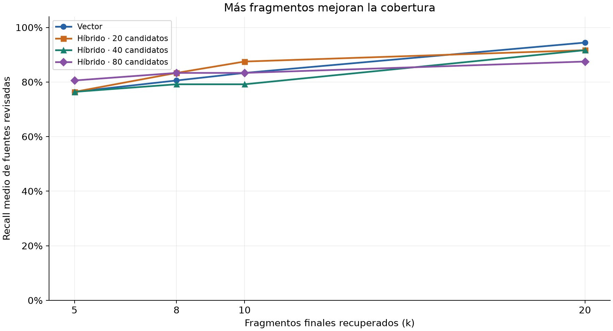
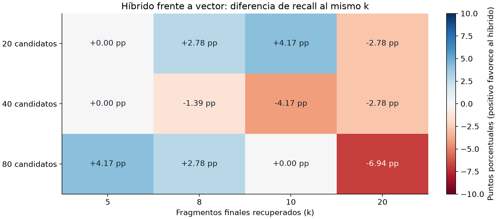
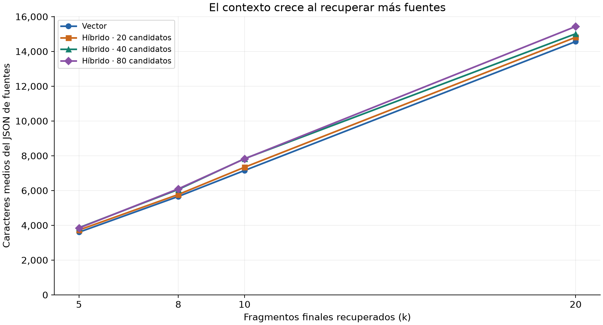
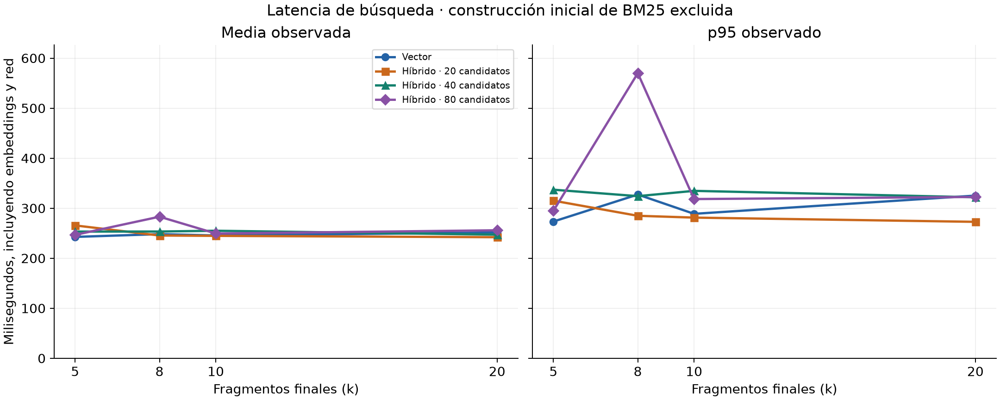
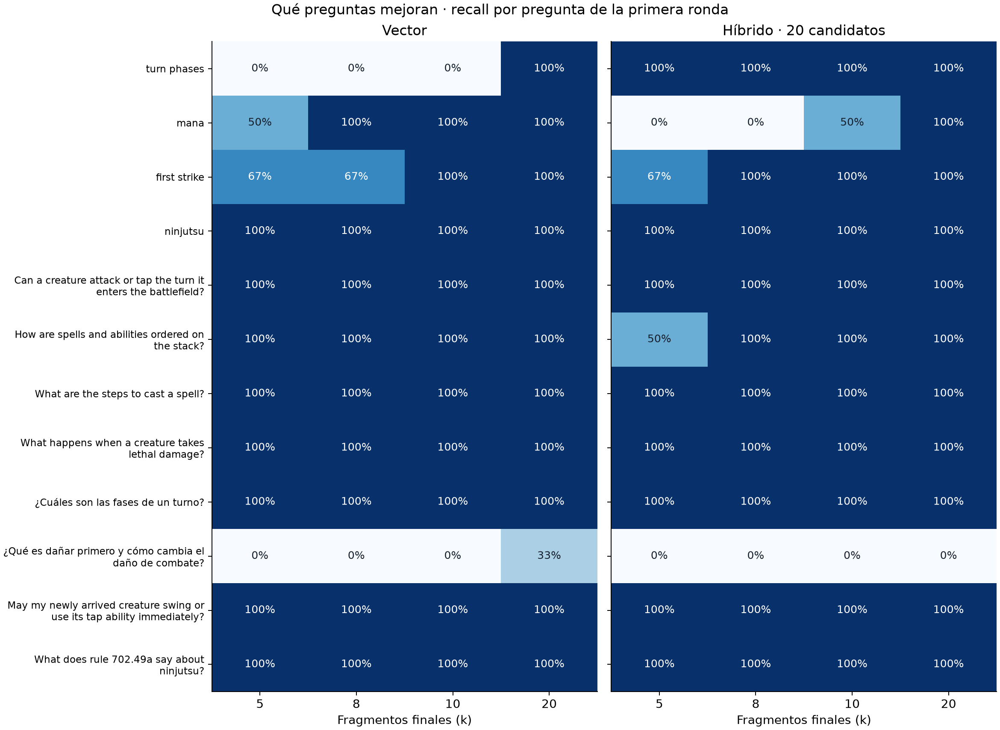

# Retrieval result counts and candidate budgets

This experiment extends the initial retrieval comparison without changing the
corpus, document boundaries or reviewed relevance judgments. It measures retrieved
source coverage, not generated answer quality.

## Reproducible design

- 4,020 documents from the April 17, 2026 edition; the same 12 questions/judgments.
- Chroma with `text-embedding-3-small`, 1,536 dimensions; unchanged BM25 and RRF.
- k=5,8,10,20 for vector retrieval and hybrid with 20,40,80 candidates per branch:
  16 configurations. Candidates are not the final source count.
- Three rounds: 576 real embedding/search calls without a query cache.
- Configuration order shuffled with seed 42 each round; fixed question order.
- Separate lexical validation/build measurement: 422.85 ms. Search latency includes
  embeddings, network, query, ranking and source materialization, excluding build.
- Collection, algorithms and defaults remained fixed during measurement.

[parameter-sweep.json](../../data/retrieval/parameter-sweep.json) retains scheduling,
configuration, complete first-round sources/candidates and all repeated results.
The portable visualization is [parameter-sweep.html](../../data/retrieval/parameter-sweep.html).

```sh
uv run --locked benchmark-retrieval --sweep --repeats 3 --output data/retrieval/parameter-sweep-local.json
uv run --locked python -m unittest discover -s tests -v
```

Sweep mode replaces `-k`, `--method` and `--candidate-limit` with the fixed matrix.
Existing corpus options remain available.

## Metric definitions

- Mean recall: fraction of reviewed sources found, averaged per question. A
  question with three relevant sources has the same weight as one with one.
- Hit rate: fraction of questions retrieving at least one reviewed source.
- Full recall: fraction retrieving all reviewed source IDs.
- MRR: mean reciprocal rank of the first reviewed hit, zero when absent.
- Context: serialized complete `SearchResult` JSON characters, including references
  and provenance, not tokens. Title/body lengths are also retained.
- Latency: observed mean, p50 and p95 using nearest rank without interpolation.
  Each configuration aggregates 36 searches: 12 questions × three rounds.
- >24,000: raw arrays exceeding the character threshold, not a workflow simulation.
  The workflow combines kinds/queries, cards and references and applies a budget.

Precision is not computed: judgments are incomplete, so an unreviewed source is
not automatically irrelevant.

## Retrieval quality



Higher values mean more reviewed evidence found. All curves use the same bank
and three rounds; connecting lines do not imply measurements at intermediate k.



Positive values favor hybrid, negative values favor vector. Units are percentage
points, not relative percentage improvement. More candidates do not uniformly help.

| Method | k | Candidates/branch | Mean recall | Hit rate | Full recall | MRR |
|---|---:|---:|---:|---:|---:|---:|
| vector | 5 | — | 76.39% | 83.33% | 66.67% | 0.5028 |
| hybrid | 5 | 20 | 76.39% | 83.33% | 66.67% | 0.5556 |
| hybrid | 5 | 40 | 76.39% | 83.33% | 66.67% | 0.5556 |
| hybrid | 5 | 80 | 80.56% | 91.67% | 66.67% | 0.5722 |
| vector | 8 | — | 80.56% | 83.33% | 75.00% | 0.5028 |
| hybrid | 8 | 20 | 83.33% | 83.33% | 83.33% | 0.5556 |
| hybrid | 8 | 40 | 79.17% | 83.33% | 75.00% | 0.5556 |
| hybrid | 8 | 80 | 83.33% | 91.67% | 75.00% | 0.5722 |
| vector | 10 | — | 83.33% | 83.33% | 83.33% | 0.5028 |
| hybrid | 10 | 20 | 87.50% | 91.67% | 83.33% | 0.5639 |
| hybrid | 10 | 40 | 79.17% | 83.33% | 75.00% | 0.5556 |
| hybrid | 10 | 80 | 83.33% | 91.67% | 75.00% | 0.5722 |
| vector | 20 | — | 94.44% | 100.00% | 91.67% | 0.5144 |
| hybrid | 20 | 20 | 91.67% | 91.67% | 91.67% | 0.5639 |
| hybrid | 20 | 40 | 91.67% | 91.67% | 91.67% | 0.5625 |
| hybrid | 20 | 80 | 87.50% | 91.67% | 83.33% | 0.5722 |

## Latency and context



Context is measured before reference expansion or workflow budgeting; it is
neither token usage nor final generation cost.



Latency includes embeddings/network and excludes lexical build. Observed p95
spikes are sample findings, not production guarantees or causal algorithm effects.

| Method | k | Candidates/branch | Mean ms | p50 ms | p95 ms | Mean context characters | Maximum | >24,000 |
|---|---:|---:|---:|---:|---:|---:|---:|---:|
| vector | 5 | — | 242.64 | 242.98 | 273.36 | 3604 | 5267 | 0/36 |
| hybrid | 5 | 20 | 265.61 | 246.38 | 315.11 | 3731 | 7439 | 0/36 |
| hybrid | 5 | 40 | 253.28 | 246.33 | 337.03 | 3862 | 7439 | 0/36 |
| hybrid | 5 | 80 | 246.70 | 240.51 | 294.72 | 3844 | 7439 | 0/36 |
| vector | 8 | — | 248.21 | 236.33 | 327.34 | 5660 | 8325 | 0/36 |
| hybrid | 8 | 20 | 245.43 | 242.87 | 284.88 | 5772 | 8985 | 0/36 |
| hybrid | 8 | 40 | 253.41 | 252.92 | 324.13 | 6062 | 9053 | 0/36 |
| hybrid | 8 | 80 | 283.04 | 252.65 | 569.94 | 6097 | 9053 | 0/36 |
| vector | 10 | — | 245.51 | 242.32 | 288.80 | 7153 | 9979 | 0/36 |
| hybrid | 10 | 20 | 244.75 | 241.81 | 281.24 | 7339 | 10891 | 0/36 |
| hybrid | 10 | 40 | 254.96 | 242.79 | 334.71 | 7831 | 11960 | 0/36 |
| hybrid | 10 | 80 | 249.48 | 246.30 | 318.32 | 7823 | 11874 | 0/36 |
| vector | 20 | — | 251.52 | 241.44 | 325.20 | 14568 | 20511 | 0/36 |
| hybrid | 20 | 20 | 242.08 | 240.13 | 272.77 | 14814 | 21177 | 0/36 |
| hybrid | 20 | 40 | 247.11 | 243.74 | 321.86 | 15015 | 20458 | 0/36 |
| hybrid | 20 | 80 | 255.88 | 250.71 | 322.54 | 15433 | 22104 | 0/36 |

## Per-question changes



Each cell is the fraction of reviewed sources retrieved. Darker blue means more
coverage. The figure uses round one; relevance metrics were identical across all
rounds. The table adds hybrid with 80 candidates. Values are recall at k=5/8/10/20.
Original Spanish questions are retained as measured input, rather than translated
and misrepresented as different benchmark queries. Exact IDs/ranks are in JSON;
judgments were not adjusted after observing results.

| Question | Vector k=5/8/10/20 | Hybrid c20 k=5/8/10/20 | Hybrid c80 k=5/8/10/20 |
|---|---|---|---|
| turn phases | 0% / 0% / 0% / 100% | 100% / 100% / 100% / 100% | 100% / 100% / 100% / 100% |
| mana | 50% / 100% / 100% / 100% | 0% / 0% / 50% / 100% | 50% / 50% / 50% / 100% |
| first strike | 67% / 67% / 100% / 100% | 67% / 100% / 100% / 100% | 67% / 100% / 100% / 100% |
| ninjutsu | 100% / 100% / 100% / 100% | 100% / 100% / 100% / 100% | 100% / 100% / 100% / 100% |
| Can a creature attack or tap the turn it enters the battlefield? | 100% / 100% / 100% / 100% | 100% / 100% / 100% / 100% | 100% / 100% / 100% / 100% |
| How are spells and abilities ordered on the stack? | 100% / 100% / 100% / 100% | 50% / 100% / 100% / 100% | 50% / 50% / 50% / 50% |
| What are the steps to cast a spell? | 100% / 100% / 100% / 100% | 100% / 100% / 100% / 100% | 100% / 100% / 100% / 100% |
| What happens when a creature takes lethal damage? | 100% / 100% / 100% / 100% | 100% / 100% / 100% / 100% | 100% / 100% / 100% / 100% |
| ¿Cuáles son las fases de un turno? | 100% / 100% / 100% / 100% | 100% / 100% / 100% / 100% | 100% / 100% / 100% / 100% |
| ¿Qué es dañar primero y cómo cambia el daño de combate? | 0% / 0% / 0% / 33% | 0% / 0% / 0% / 0% | 0% / 0% / 0% / 0% |
| May my newly arrived creature swing or use its tap ability immediately? | 100% / 100% / 100% / 100% | 100% / 100% / 100% / 100% | 100% / 100% / 100% / 100% |
| What does rule 702.49a say about ninjutsu? | 100% / 100% / 100% / 100% | 100% / 100% / 100% / 100% | 100% / 100% / 100% / 100% |

## Interpretation and limits

Increasing final results improves retrieval on this bank. Vector recall rises
from 76.39% at k=5 to 80.56%, 83.33% and 94.44% at k=8,10,20. Mean context grows
from 3,604 to 14,568 characters: 4.04 times the context for 18.06 percentage points
of recall. No raw array exceeds 24,000; the overall maximum is 22,104. This does
not ensure workflow fit after multiple queries and reference expansion.

Specific source ranks explain the gains:

- `106.1` for `mana` is vector rank 6, appearing at k=8.
- `702.7b` for `first strike` is vector rank 10; hybrid c20 ranks it seventh.
- `500.1` for `turn phases` is vector rank 13, while hybrid retrieves it at k=5.
- The Spanish first-strike question retrieves only `702.7b`, at vector rank 16:
  one-third recall at k=20; all hybrid variants remain at zero. Vector k=20 and
  hybrid k=20/c20 recover all reviewed sources for the ten English questions;
  the Spanish hit accounts for their final mean difference.

Increasing hybrid candidates does not guarantee improvement. At k=10, c20 reaches
87.50%, c40 falls to 79.17% and c80 reaches 83.33%. New candidates can receive a
second RRF contribution and overtake sources matching one branch only. For the
stack question, `405.1` retains vector rank 2 and the same RRF score but moves
from fused rank 6 at c20 to rank 33 at c80, outside even k=20. At k=5, c80 improves
the mean to 80.56% but still loses some reviewed stack evidence versus vector.

Observed tradeoffs:

- Vector k=20 has the matrix's highest recall, 94.44%, and 14,568 mean characters.
- Hybrid k=10/c20 has 87.50% recall with 7,339 characters, about half the context.
  Its MRR is 0.5639 versus 0.5144: earlier first hits, less total coverage.
- Hybrid k=8/c20 matches vector k=10's 83.33% recall with 5,772 characters, but
  retrieves different sources and still misses `mana` completely.
- Hybrid c80's maximum MRR, 0.5722, does not coincide with maximum recall.

Mean search latency spans 242–283 ms. Four times the k does not mean four times
the latency: the small embedding request and network trip remain substantial.
Individual phases were not instrumented to assign exact proportions. Sending more
context to a generator may still increase cost even if search time is similar.
Observed p95 reaches 569.94 ms; this is neither a production guarantee nor
statistical proof of a faster method. Lexical build took a separate 422.85 ms.

Relevance metrics remained identical across three rounds. Only two list/order
changes occurred relative to round one, both at c40, without changing recall or
first hit. Chroma is approximate and embeddings can have small numeric variation;
no specific cause is assigned without further instrumentation.

The original k=5 exploration was insufficient. The matrix demonstrates improved
coverage with more sources and useful hybrid tradeoffs, not a universal winner.
Defaults stayed fixed during measurement; after reviewing results, the current
default became **vector k=20**, retaining the 24,000-character workflow budget.
This does not establish full-answer quality. The original promotion criterion
applied to k=5; none of its new variants removes individual regressions. Larger-k
results are exploratory, not a retroactive change to that criterion.

Parser boundaries, Spanish queries and relevance judgments were unchanged. Before
choosing production k, measure which sources survive the actual workflow budget
and the quality/cost of generated answers. Twelve related questions, including
only two Spanish questions, cannot represent all rules or real user traffic.

## Regenerating figures

The five PNGs are in `docs/experiments/images/retrieval/` and use relative Markdown links.
They are derived from saved JSON without new model calls. The original portable
HTML remains a historical experiment artifact.
