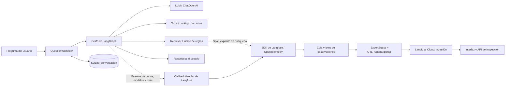
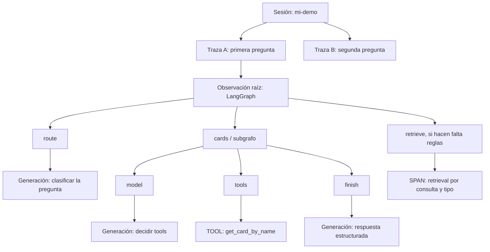
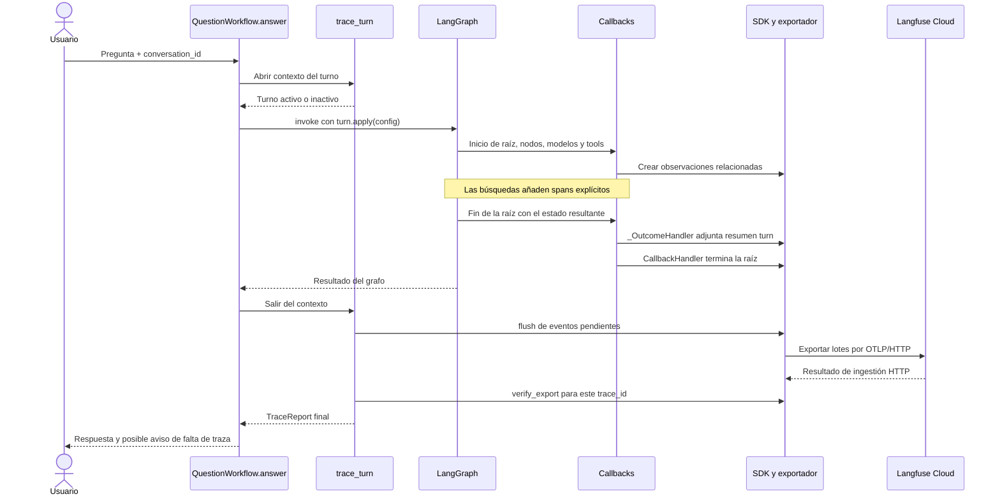
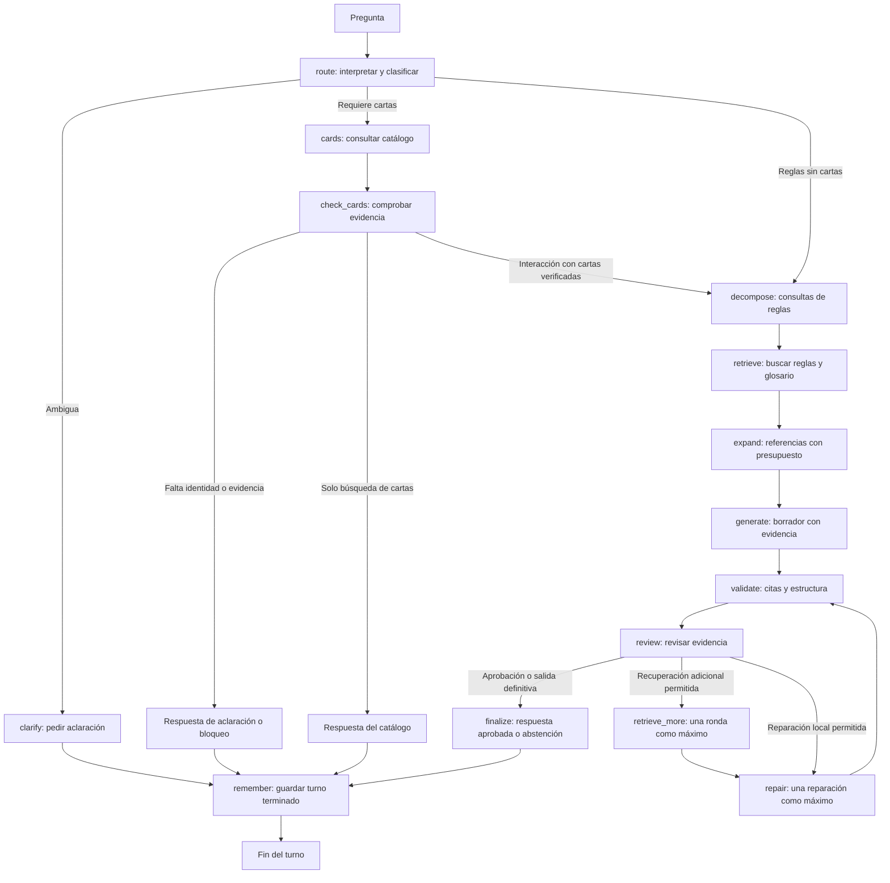
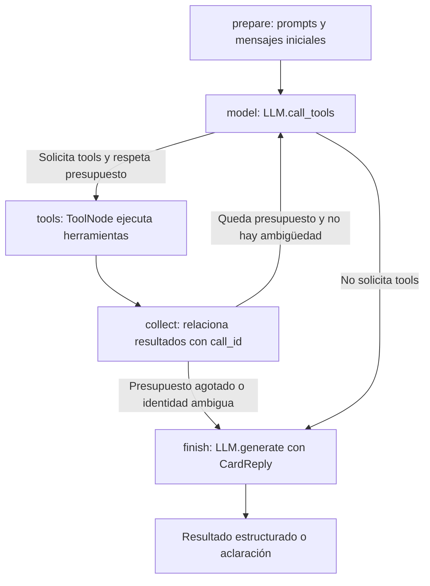
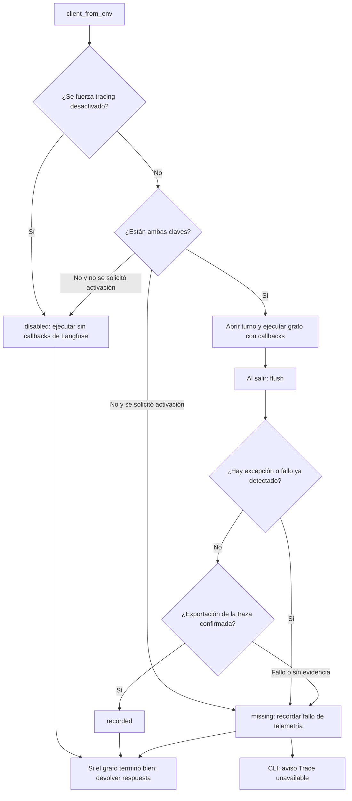

# Observabilidad: entender Langfuse y el tracing de Magic Bot

Esta guía explica qué ocurre desde que haces una pregunta hasta que puedes
inspeccionar su ejecución en Langfuse. Los nombres de funciones y nodos son los
que aparecen en el código. Los diagramas muestran relaciones y decisiones;
no todas las preguntas recorren todos los nodos.

Recorrido de lectura:

1. [Qué es Langfuse](#1-qué-es-langfuse-y-para-qué-lo-usamos).
2. [Componentes y arquitectura](#2-qué-responsabilidad-tiene-cada-componente).
3. [Sesiones, trazas y generaciones](#3-sesión-turno-traza-observación-y-generación).
4. [Código, clases y funciones](#4-mapa-del-código-por-dónde-empezar-a-leer).
5. [Flujo del bot, cartas y reglas](#5-cómo-se-ve-el-flujo-funcional-de-nuestro-bot).
6. [Tiempos, tokens y costes](#6-cómo-interpretamos-tiempos-tokens-y-costes).
7. [Envío, confirmación y errores](#7-cómo-enviamos-los-datos-y-cómo-tratamos-los-fallos).
8. [Cuenta, configuración y ejemplos](#8-cuenta-claves-y-configuración-local).
9. [Datos enviados y salidas locales](#9-qué-datos-salen-del-ordenador).
10. [Inspección y diagnóstico](#10-cómo-investigar-una-ejecución-en-langfuse).
11. [Pruebas, demostración real y streaming](#11-qué-está-probado-y-cuáles-son-los-límites).

## 1. Qué es Langfuse y para qué lo usamos

Langfuse es una plataforma de observabilidad para aplicaciones que utilizan
modelos de lenguaje. Recibe registros de ejecución y permite inspeccionar
preguntas, llamadas al modelo, herramientas, tiempos y consumos disponibles.
Su [modelo de datos](https://langfuse.com/docs/observability/data-model) organiza
las ejecuciones mediante trazas y observaciones.

Por ejemplo, si el bot responde mal sobre Lightning Bolt, queremos averiguar:

- Si entendió la pregunta y eligió la ruta adecuada.
- Si consultó la carta correcta y qué argumentos utilizó.
- Qué consulta recuperó cada regla y qué fuentes llegaron al modelo.
- Qué instrucciones se ejecutaron y con qué versión.
- Si la revisión rechazó el borrador y hubo una reparación.
- Qué llamada tardó más y qué consumo comunicó el proveedor.

Langfuse hace visible esa información que nuestro programa y sus bibliotecas
registran. La búsqueda de reglas, el acceso al catálogo y la generación de
respuestas siguen ejecutándose en Magic Bot. El veredicto `approved` de una
revisión procede de nuestro nodo `review` y de sus comprobaciones en Python;
no representa una certificación de Langfuse de que la respuesta sea correcta.

En este proyecto usamos Langfuse para tracing. Los prompts siguen en Markdown
versionado dentro de `backend/prompts/`, y SQLite conserva la conversación.
La plataforma ofrece otras funciones, pero esta implementación no configura
gestión remota de prompts, alertas ni un servidor propio.

## 2. Qué responsabilidad tiene cada componente

| Componente | Responsabilidad en nuestro proyecto |
| --- | --- |
| Magic Bot | Decide qué pasos ejecutar, busca evidencia y construye la respuesta. |
| LangGraph | Ejecuta el grafo y sus subgrafos; comunica el inicio, fin y error de sus operaciones. |
| LangChain | Proporciona el modelo `ChatOpenAI`, mensajes y herramientas con callbacks compatibles. |
| SDK de Langfuse | Convierte esos eventos en observaciones y prepara su envío. |
| OpenTelemetry | Proporciona spans, contexto y exportación de telemetría. |
| Exportador OTLP/HTTP | Envía lotes al endpoint de ingestión de Langfuse. OTLP es el protocolo de telemetría utilizado. |
| Langfuse Cloud | Recibe y procesa los datos; permite consultarlos mediante interfaz y API. |

Un **SDK** es una biblioteca que utilizamos desde Python. Un **callback** es un
objeto al que otra biblioteca avisa cuando ocurre algo, por ejemplo «empezó una
llamada al modelo». **Instrumentar** significa añadir ese registro de actividad.

La [integración oficial con LangChain](https://langfuse.com/integrations/frameworks/langchain)
proporciona `CallbackHandler`; reutilizamos ese mecanismo para nodos, modelos y
herramientas. Añadimos un span explícito donde nuestro buscador propio necesita
registrar consultas y resultados.



Las líneas discontinuas representan el registro de telemetría. Las consultas al
modelo y al catálogo tienen sus propias conexiones; Langfuse no actúa como
intermediario de esas peticiones. Aunque un fallo de telemetría no debe romper
la respuesta, `flush()` sí puede añadir espera al final del turno.

## 3. Sesión, turno, traza, observación y generación

Estos conceptos tienen distintos identificadores y funciones:

| Concepto | Qué significa aquí | Ejemplo |
| --- | --- | --- |
| Conversación | Historial persistido localmente entre preguntas. | `conversation_id="mi-demo"`. |
| Sesión de Langfuse | Agrupación de trazas de esa conversación. | `langfuse_session_id="mi-demo"`. |
| Turno | Una pregunta y la ejecución que intenta responderla. | «¿Qué hace Lightning Bolt?». |
| Traza | Conjunto de observaciones de un turno, con un `trace_id` compartido. | Una ejecución completa de `answer()`. |
| Observación | Registro de una operación, con tiempos, datos y relación con su padre. | El nodo `cards` o una herramienta. |
| Span | Término de OpenTelemetry para una operación; en Langfuse también existe el tipo específico `SPAN`. | Nuestro span explícito `retrieval`. |
| Generación | Observación correspondiente a una llamada al modelo. | La llamada estructurada bajo `finish`. |

Los nodos nativos pueden aparecer con tipo `CHAIN`, las herramientas como `TOOL`
y los modelos como `GENERATION`. Usar la expresión «span de un nodo» no implica
que todos tengan exactamente el mismo tipo en la interfaz.



Este árbol es un ejemplo simplificado: LangChain puede añadir observaciones
intermedias como `RunnableSequence`, y `model` puede ejecutarse varias veces.
Las flechas de este diagrama significan agrupación o parentesco, no orden temporal.

En `magic-chat`, reutilizar `--conversation-id` agrupa los turnos y recupera el
historial local si se utiliza la misma base SQLite. Repetir ese identificador
con otra base vacía permite agrupar trazas en Langfuse, pero no recupera por sí
solo el historial de la base anterior.

En `card-chat` no guardamos una conversación: cada llamada a `CardAgent.answer()`
genera una sesión nueva con `uuid4()` y una única traza. Una sesión de Langfuse
no sustituye al almacenamiento de memoria.

## 4. Mapa del código: por dónde empezar a leer

| Archivo | Qué debes buscar |
| --- | --- |
| [workflow/cli.py](../backend/workflow/cli.py) | Lee los argumentos, ejecuta el workflow y muestra respuesta, eventos o JSON. |
| [workflow/graph.py](../backend/workflow/graph.py) | `build_graph()`, `_tracing()`, `answer()` y `stream()`. |
| [workflow/nodes.py](../backend/workflow/nodes.py) | Operaciones del bot; `_search()` instrumenta la recuperación. |
| [cards/agent.py](../backend/cards/agent.py) | `build_card_graph()` y la entrada independiente `CardAgent.answer()`. |
| [cards/tools.py](../backend/cards/tools.py) | `search_cards` y `get_card_by_name`, declaradas con `@tool`. |
| [generation/llm.py](../backend/generation/llm.py) | `generate()` para salida estructurada y `call_tools()` para solicitar herramientas. |
| [common/tracing.py](../backend/common/tracing.py) | Configuración, callbacks, spans de búsqueda y resultado de exportación. |
| [common/prompts.py](../backend/common/prompts.py) | Carga de Markdown, versión, hash y renderizado del prompt. |
| [workflow/memory.py](../backend/workflow/memory.py) | SQLite, exclusión entre turnos de una conversación y tipos permitidos al deserializar. |
| [test_tracing.py](../tests/test_tracing.py) | Correlación y comportamiento ante errores de telemetría. |

### 4.1 Entrada del turno y propagación de callbacks

`QuestionWorkflow._tracing(conversation_id)` pasa a `trace_turn()` el identificador
de sesión, el nombre `question-turn`, modelo, esfuerzo de razonamiento y, cuando
se especifica, edición de reglas.

El siguiente fragmento resume la integración de `answer()`; se han omitido la
apertura de recursos, el bloqueo de conversación y algunos `finally`:

```python
with self._tracing(conversation_id) as turn:
    try:
        state, config = self._prepare_turn(question, conversation_id)
        result = self.graph.invoke(state, turn.apply(config))
    except Exception as exc:
        turn.fail(exc)
        raise
```

`_prepare_turn()` recupera el historial y reinicia los campos temporales. Su
configuración contiene `configurable.thread_id`, utilizado por el checkpointer.
`turn.apply(config)` conserva esa configuración y añade callbacks y metadatos.
El SDK utiliza `langfuse_session_id` para agrupar trazas en Langfuse.

El grafo se ejecuta una sola vez. Los componentes LangChain llamados dentro de
sus nodos heredan el contexto de callbacks. Por eso `LLM.generate()` y
`LLM.call_tools()` no necesitan crear otra traza manual para cada petición.
`ChatOpenAI` mantiene la comunicación con el proveedor y sus mensajes nativos.



El diagrama representa la ruta con tracing activo y finalización normal. El SDK
puede enviar lotes durante la ejecución; `flush()` fuerza el envío pendiente al
salir. La interfaz o las consultas pueden tardar en reflejar la ingestión.

### 4.2 Qué hace cada pieza de tracing.py

- **`TraceReport`** guarda `status`, `trace_id` y `detail`. Describe la telemetría;
  no es el veredicto sobre la respuesta del bot.
- **`client_from_env()`** carga `.env` sin sustituir variables de entorno ya
  presentes, decide si activar tracing y exige ambas claves cuando se solicita.
- **`_client()`** usa `lru_cache(maxsize=1)` para reutilizar la pareja cliente y
  exportador con la misma configuración. Langfuse comparte recursos por proyecto;
  crear un adaptador desconectado en cada turno impediría comprobar sus envíos.
- **`_LangfuseClient`** configura el SDK y el exportador HTTP autenticado. `open()`
  crea un `CallbackHandler` nuevo para el turno; `flush()` vacía la cola del SDK.
- **`_InactiveTurn`** permite usar el mismo `with` con tracing apagado o fallido.
  `apply()` devuelve la configuración original y no crea observaciones.
- **`_ActiveTurn`** añade metadatos y callbacks, construye el resumen y conserva
  el primer fallo de telemetría mediante `mark_missing()`.
- **`_OutcomeHandler`** observa el fin o error de la raíz. Se coloca antes del
  callback de Langfuse para adjuntar el resumen mientras la raíz sigue abierta.
  No crea otro árbol de spans paralelo.
- **`_LangfuseSession`** mantiene el callback y los metadatos de ese turno,
  actualiza la raíz con `finish()`, abre spans de búsqueda y comprueba el envío
  con `verify_export()`. Aunque la clase se llama Session, representa un turno;
  la sesión que ves en Langfuse la determina `langfuse_session_id`.
- **`_ExportStatus`** conserva el resultado de exportación por `trace_id`. Se
  explica en la sección de errores. No suma tokens ni calcula precios.
- **`warn_missing_trace()`** muestra el aviso de consola cuando el resultado
  final es `missing`.

Un **gestor de contexto** es lo que se utiliza con `with`: prepara recursos al
entrar y ejecuta la limpieza al salir, incluso si ocurre una excepción.
`trace_turn()` emplea `try/finally` para vaciar eventos y restaurar el contexto.
El workflow guarda `turn.report` en `workflow.trace_report` al finalizar.

`_current` es una `ContextVar`: mantiene el turno activo en el contexto de
la ejecución. Así `_search()` puede registrar su span sin recibir un parámetro
`turn` en toda la cadena de funciones. Un token de contexto permite restaurar
el valor anterior al salir. El `Lock` de `_ExportStatus` tiene otra finalidad:
proteger los resultados que también escribe el hilo de exportación.

### 4.3 Qué registra summarize_turn()

El callback nativo ya registra entradas y salidas. `summarize_turn()` selecciona
información del estado para facilitar la lectura en los metadatos de la raíz:

| Campo | Cómo interpretarlo |
| --- | --- |
| `question`, `model`, `reasoning_effort` | Pregunta y configuración del modelo. Si faltan modelo/esfuerzo en el estado, se recuperan de los metadatos del turno. |
| `rules_edition`, `source_editions` | Filtro de edición solicitado y ediciones de las fuentes conservadas. Un filtro nulo permite buscar sin fijar edición. |
| `prompts` | Nombre, versión y SHA-256 de los prompts registrados en el estado del turno. |
| `queries`, `repair_queries` | Consultas iniciales y propuestas para una recuperación adicional. Una propuesta no implica que haya llegado a ejecutarse. |
| `retrieved_ids` | Fuentes del contexto final, después de expansión y presupuesto. |
| `tools` | Nombre, argumentos, `call_id`, estado y tipo de error de cada intercambio conservado. |
| `review` | Último registro de revisión, con el resultado de las comprobaciones del workflow. |
| `additional_retrievals`, `repairs` | Contadores de recuperación adicional y reparación. |
| `reason`, `validation_error`, `error` | Motivo de salida, problema de validación y tipo de excepción cuando corresponde. |

`_prompt_metadata()` combina `card_prompts` y `prompts`. Solo conserva entradas
con versión y hash; no vuelca todo el catálogo de prompts disponibles. El hash
identifica el contenido exacto del archivo cargado: dos archivos con el mismo
nombre y versión pero distinto contenido tendrán hashes diferentes.

`_retrieved()` obtiene IDs y ediciones del contexto y `_tools()` reduce los
intercambios de herramientas a un resumen. Ese resumen no contiene mensajes,
razonamiento cifrado ni un total paralelo de tokens o costes. Los callbacks
nativos sí pueden conservar información más extensa, como se explica después.
Ante una excepción que aborta el grafo, el resumen de error puede ser parcial;
las observaciones previas son necesarias para investigar lo que llegó a ocurrir.

## 5. Cómo se ve el flujo funcional de nuestro bot

El tracing acompaña este flujo que ya existía. Clasificar una pregunta de cartas
no significa resolver una interacción: las interacciones necesitan también
fuentes de reglas y revisión de la respuesta.



`after_review()` comprueba los contadores antes de permitir más pasos. Después
de una reparación vuelve a haber validación y revisión, pero no se abre un
bucle ilimitado. Una revisión rechazada puede terminar en abstención. La traza
permite distinguir esas salidas de una respuesta aprobada.

### 5.1 Dentro del subgrafo de cartas



`prepare` carga los prompts y construye los mensajes. `model` deja que el modelo
solicite herramientas y comprueba IDs y presupuesto; una petición inválida puede
producir una excepción. `ToolNode` valida y ejecuta `get_card_by_name` o
`search_cards`. `collect` une cada resultado con su petición y acumula evidencia.

`finish` hace otra llamada al modelo para producir `CardReply`, sin herramientas
adjuntas, y comprueba que los nombres citados estén respaldados. Por eso hay
una generación bajo `model` y otra distinta bajo `finish`. Un nodo `model`
puede repetirse y producir varias generaciones en el mismo turno.

El identificador `tool_call_id` de una observación de herramienta corresponde al
`call_id` guardado en `exchanges` y en `turn.tools`. Sirve para saber qué
resultado pertenece a qué solicitud, incluso cuando se repite una herramienta.

El namespace expresa la ubicación en el subgrafo. Por ejemplo,
`cards:<id>|tools:<id>` indica que `tools` se ejecutó dentro de `cards`.
Los sufijos son identificadores de ejecución, no versiones de prompts. Los
`parent_observation_id` relacionan las observaciones; el namespace añade la
ubicación dentro de LangGraph.

### 5.2 Por qué añadimos retrieval_observation()

Nuestro `Retriever` tiene métodos `search()` y `get()`, pero no es un retriever
nativo de LangChain. El callback del nodo por sí solo no describe qué consulta
produjo cada fuente. Por eso `WorkflowNodes._search()` hace lo siguiente:

```python
with retrieval_observation(query, kind=kind, edition=self.version) as observed:
    hits = self.retriever.search(query, k=self.k, kind=kind, version=self.version)
    observed.sources(hit.id for hit in hits)
    return hits
```

`_Sources` guarda los IDs. `retrieval_observation()` mide el tiempo con
`time.perf_counter()` y, al salir, registra consulta, tipo (`rule` o `glossary`),
edición, IDs, error y latencia en milisegundos. `_LangfuseRetrieval.end()` actualiza
y cierra el span, restaurando el contexto aunque falle la actualización.

Cada consulta inicial se busca por separado en reglas y glosario; una consulta
puede crear dos spans `retrieval`. `retrieve_more()` utiliza el mismo `_search()`
para las búsquedas adicionales realmente ejecutadas.

Los IDs de un span son los resultados de esa búsqueda **antes** de aplicar el
presupuesto de contexto. `turn.retrieved_ids` refleja el contexto final: puede
eliminar resultados, deduplicarlos y añadir fuentes mediante expansión de
referencias. Por tanto, ambas listas tienen finalidades distintas.

Este span mide el tiempo total de `search()`, que puede incluir la petición de
embeddings y el ranking. No crea por sí mismo una generación ni registra tokens
de embeddings. Tampoco crea un span individual por cada `get()` de la expansión;
el nodo `expand` y sus entradas/salidas proporcionan esa visibilidad general.

## 6. Cómo interpretamos tiempos, tokens y costes

La **latencia** de una observación es su duración. La duración de un padre
incluye el tiempo de sus hijos: sumar todas las duraciones anidadas no da el
tiempo real de espera del usuario. `retrieval` añade también `latency_ms` en sus
metadatos. El tiempo del comando puede incluir apertura de recursos y `flush()`,
además del intervalo observado por la raíz del grafo.

Los **tokens** son unidades de texto u otros contenidos que contabiliza el
proveedor del modelo. La entrada incluye instrucciones, historial y evidencia,
además de tu pregunta. La salida puede incluir categorías de razonamiento
contabilizadas por el proveedor; no implica que veamos un razonamiento legible.

La integración nativa toma el consumo que devuelve el modelo. Lo registramos en
las generaciones, cuando existe. Los padres `cards` y `LangGraph` no reciben un
segundo consumo escrito por nuestro código. Por ejemplo, si dos generaciones
comunican 100 y 200 tokens, sumarlas da 300; sumar además un total agregado que
muestre su padre volvería a contar esos mismos tokens.

Algunos proveedores desglosan entrada/salida, caché y razonamiento. Conviene
leer las categorías y el total comunicado sin volver a sumar un total junto con
sus componentes. Un dato ausente no demuestra que el consumo fuera cero.

Los **costes** requieren consumo y precios aplicables al modelo. Magic Bot no
mantiene una tabla paralela de tarifas ni escribe precios desconocidos como
cero. Langfuse puede calcularlos si reconoce el modelo y sus precios. Un cero
que el callback escriba en una observación fallida sin uso de tokens no es una
medición fiable de coste; hay que inspeccionar el contexto de esa observación.

## 7. Cómo enviamos los datos y cómo tratamos los fallos

El SDK prepara observaciones y las exporta en lotes. No hace falta una petición
HTTP por cada nodo. Al terminar un turno, `trace_turn()` llama a `flush()` para
que un script corto no cierre con eventos pendientes.

La implementación utiliza la opción pública
[`span_exporter` del SDK](https://python.reference.langfuse.com/langfuse).
`_LangfuseClient` configura un `OTLPSpanExporter` con autenticación HTTP Basic
mediante las claves del proyecto, un timeout de cinco segundos y el endpoint
`<LANGFUSE_BASE_URL>/api/public/otel/v1/traces`.

Base64, utilizado en HTTP Basic, es una codificación y no cifra las claves;
la conexión HTTPS protege el transporte en Langfuse Cloud. El encabezado
`x-langfuse-ingestion-version: 4` selecciona la ruta de ingestión utilizada.
El exportador estándar conserva la responsabilidad de transporte y reintentos.

### 7.1 El fallo que corregimos

El exportador de OpenTelemetry puede devolver `SpanExportResult.FAILURE` sin
que `flush()` lance una excepción. Antes, el código interpretaba la ausencia
de excepción como éxito y podía dejar `recorded` aunque no hubiera envío.

Ahora `_ExportStatus.export()` observa ese resultado y guarda un booleano por
cada `trace_id` del lote. Un lote puede contener varias trazas y una traza puede
necesitar varios lotes. Si alguno falla, un éxito posterior no borra el fallo.
También registra como fallida una exportación que lance una excepción.

Su `Lock` protege las escrituras desde el hilo exportador y la lectura al
terminar el turno. `consume()` retira el resultado consultado. El registro está
limitado a 1024 trazas recientes para que una ejecución interrumpida no acumule
resultados indefinidamente. Si un resultado ya no está disponible, se informa
como no confirmado, sin inventar un éxito.

Tras `flush()`, `_LangfuseSession.verify_export()` exige un resultado positivo
para la traza del turno. No crea spans ni consulta repetidamente la API de
Langfuse para verificar cada respuesta.



El diagrama resume las decisiones; también se capturan fallos al inicializar el
cliente, abrir observaciones o adjuntar metadatos. `mark_missing()` conserva el
primer motivo seguro para no sustituirlo por un error posterior.

### 7.2 Qué significa TraceReport

| Estado final | Significado |
| --- | --- |
| `disabled` | No se solicitó tracing o se desactivó por configuración. |
| `recorded` | Se observó exportación correcta para la traza, sin fallos de telemetría detectados. |
| `missing` | Se solicitó tracing, pero falló alguna operación o no pudo confirmarse la exportación. |

Durante la ejecución el estado puede ser provisional: consulta `trace_report`
cuando `answer()` haya terminado o el iterador de `stream()` se haya cerrado.
`recorded` no garantiza que la interfaz ya muestre la traza ni certifica que
todos los contenidos posibles se hayan instrumentado. La ingestión es un paso
separado, y estas comprobaciones tampoco sustituyen la evaluación de respuestas.

Si falla el modelo, el índice o una operación del grafo, la excepción se registra
y sigue su curso; no la convertimos en una respuesta válida. Algunas situaciones
de salida estructurada no disponible ya tienen una política explícita de
abstención en los nodos. La tolerancia a fallos añadida por tracing se aplica a
la telemetría, no a ocultar errores funcionales.

En un turno que sí produjo respuesta, `warn_missing_trace()` puede escribir:

```text
Trace unavailable (Langfuse export failed or unconfirmed). The answer was still produced.
```

## 8. Cuenta, claves y configuración local

Para utilizar Langfuse Cloud necesitas acceso a una cuenta y a un proyecto.
De ese proyecto obtienes dos claves: `LANGFUSE_PUBLIC_KEY` y
`LANGFUSE_SECRET_KEY`. Las claves de OpenAI y Langfuse tienen funciones separadas:
la primera autentica las peticiones al modelo; las de Langfuse autentican la
telemetría. Tener claves de Langfuse no proporciona acceso al modelo.

Guarda estos valores en `.env` local, que Git ignora. Los siguientes son
marcadores de ejemplo, no credenciales válidas:

```dotenv
LANGFUSE_PUBLIC_KEY=<clave pública del proyecto>
LANGFUSE_SECRET_KEY=<clave secreta del proyecto>
LANGFUSE_BASE_URL=https://cloud.langfuse.com
LANGFUSE_TRACING_ENABLED=true
```

`LANGFUSE_BASE_URL` debe corresponder a la región de tu proyecto o a la instancia
propia que utilices. El valor del ejemplo corresponde a Cloud EU. Las
[instrucciones oficiales de configuración](https://langfuse.com/integrations/frameworks/langchain)
explican las regiones y la obtención de claves. Este repositorio no despliega
una instancia de Langfuse.

La lógica de activación es la siguiente:

- `LANGFUSE_TRACING_ENABLED=false` fuerza la desactivación, incluso con claves.
- Con ambas claves, dejar el flag sin definir o ponerlo en `true` activa tracing.
- Sin ambas claves y sin activación explícita, tracing queda desactivado.
- Con activación explícita pero claves incompletas, el resultado es `missing`;
  el bot sigue pudiendo responder si sus demás dependencias funcionan.

Se aceptan también `0/no/off` y `1/yes/on`, sin distinguir mayúsculas, en los
casos correspondientes. Las variables de entorno del proceso tienen prioridad
sobre `.env`. Reinicia el comando o proceso al cambiar credenciales: el SDK y
nuestro cliente reutilizan recursos, y no hay una función de recarga en caliente.

### 8.1 Demostración con una conversación

Con las dependencias, el modelo y el índice de reglas preparados, ejecuta:

```sh
uv run --locked magic-chat --conversation-id mi-demo-langfuse \
  'Busca la carta Lightning Bolt.'

uv run --locked magic-chat --conversation-id mi-demo-langfuse \
  '¿Puede hacer objetivo a una criatura con protección contra rojo?'

uv run --locked magic-chat --conversation-id mi-demo-langfuse \
  'Busca cartas blancas de subtipo Warrior con valor de maná menor que 2.'
```

Los tres comandos reutilizan la base de memoria por defecto y el mismo ID de
conversación. En Langfuse, abre Sessions y busca `mi-demo-langfuse`. Cada nueva
pregunta produce otra traza. Ejecutar estos comandos utiliza servicios reales,
incluidas las llamadas al modelo y, para reglas, embeddings cuando corresponda.

## 9. Qué datos salen del ordenador

Con tracing activado, los callbacks nativos pueden enviar entradas y salidas de
nodos, incluidos pregunta, historial seleccionado, prompts renderizados,
respuestas, argumentos de tools, resultados del catálogo y texto de reglas.
Los mensajes del modelo pueden contener el elemento de razonamiento cifrado
que el proveedor utiliza para continuar un ciclo de herramientas.

Las claves de API no se añaden al resumen `turn`. Esto no significa que todos
los datos registrados se anonimicen automáticamente: el resumen reduce los
errores a su tipo, pero un callback nativo puede conservar el texto original de
una excepción. Conviene tener presente el contenido que se está ejecutando
cuando se utiliza un proyecto de Langfuse compartido.

Con tracing desactivado no se envía esta telemetría a Langfuse. El bot conserva
sus conexiones funcionales al modelo y al catálogo cuando son necesarias.

Hay cuatro salidas diferentes que conviene distinguir:

| Salida | Uso |
| --- | --- |
| Langfuse | Inspección detallada de ejecuciones, con contenido interno y metadatos. |
| `state["trace"]` | Lista local de depuración que `_traced()` construye con nodos, campos, consultas y fuentes. |
| `card-chat --trace` | Presentación compacta de llamadas, argumentos y estados en consola. |
| `magic-chat --events` | Emisión de ID de conversación, namespaces y nombres de nodos completados. |

`--trace` no activa Langfuse. `--events` no ejecuta de nuevo el grafo ni publica
los mensajes crudos. La salida `--json` sí es diagnóstico interno completo y
puede contener mucha más información. Ninguna de estas salidas debe confundirse
con un contrato público de una futura interfaz web.

## 10. Cómo investigar una ejecución en Langfuse

1. Busca la sesión por `conversation_id` y abre la traza de la pregunta.
2. Localiza la raíz del grafo, habitualmente llamada `LangGraph`. Comprueba
   pregunta, modelo, edición de fuentes y metadatos del turno.
3. Inspecciona `route` para entender la clasificación y la pregunta normalizada.
4. Si hubo cartas, despliega `cards`. En cada herramienta, revisa argumentos,
   resultado, estado, `tool_call_id` y namespace. Relaciona el ID con `turn.tools`.
5. Si hubo reglas, abre cada `retrieval`. Lee consulta, tipo de búsqueda y
   `source_ids`; compáralos con `turn.retrieved_ids` y con el nodo `expand`.
6. Examina las generaciones bajo `generate`, `review` y, si existió, `repair`.
   Comprueba la evidencia disponible y las objeciones de la revisión.
7. Revisa las generaciones bajo `model` y `finish` por separado. Compara sus
   tiempos y consumos; el padre solo organiza esas operaciones.
8. Comprueba el resultado final: aprobación, aclaración, abstención o error.
   Que la traza se haya exportado correctamente no determina ese resultado.

En SDK v5 los metadatos pueden aparecer aplanados: por ejemplo,
`turn.prompts.route.version`, `turn.prompts.route.sha256`, `turn.retrieved_ids`
y `turn.review.approved`, en lugar de un único objeto `turn` expandible.
Pueden aparecer nodos auxiliares del framework entre los descritos en esta guía.

Si consultas por código, la API de observaciones permite obtener los campos que
necesitas. Ejemplo ejecutado desde un archivo Python con `.env` disponible:

```python
from dotenv import load_dotenv
from langfuse import get_client

load_dotenv()
langfuse = get_client()
response = langfuse.api.observations.get_many(
    session_id="mi-demo-langfuse",
    fields="core,basic,metadata,usage",
    expand_metadata="turn.retrieved_ids,turn.queries,turn.tools",
    limit=100,
)
```

Es una consulta, no una ejecución del bot. La API devuelve observaciones: para
reconstruir el árbol se utilizan `trace_id`, `id` y `parent_observation_id`.
Si hay más resultados, hay que continuar con el cursor de paginación.
`expand_metadata` pide valores completos para esas claves; la respuesta por
defecto recorta metadatos largos a 200 caracteres. Ese recorte de la consulta
no demuestra que se hayan perdido los datos almacenados. No añadas
`parse_io_as_json=True`: el endpoint observado rechaza ese parámetro y devuelve
entradas/salidas como cadenas.

### 10.1 Problemas habituales

| Síntoma | Qué comprobar |
| --- | --- |
| No aparece ninguna traza | Ambas claves, flag de activación, región y avisos del comando. |
| `missing Langfuse keys` | Se activó tracing sin tener las dos claves disponibles en el proceso. |
| `Langfuse export failed or unconfirmed` | Acceso al endpoint, credenciales, región y configuración de muestreo. La etiqueta agrupa fallo o ausencia de confirmación. |
| `recorded` pero aún no se ve en la interfaz | Tiempo de ingestión, proyecto, sesión y filtros de fechas/entorno. |
| Falta un nodo en la traza | La ruta puede no haberlo ejecutado; una aclaración no necesita buscar reglas. |
| No hay tokens en `cards` | Revisa las generaciones hijas: el padre no registra consumo propio. |
| Los IDs de búsqueda difieren del contexto final | Deduplicación, presupuesto, expansión de referencias o búsquedas de reparación. |
| El historial no continúa | Mismo ID y misma base SQLite; compartir sesión en Langfuse no restaura memoria. |

## 11. Qué está probado y cuáles son los límites

La comprobación del 2026-11-02 ejecutó **78 tests versionados**, todos correctos,
con `LANGFUSE_TRACING_ENABLED=false` para no enviar las fixtures locales.
Las cinco pruebas de [tracing](../tests/test_tracing.py) comprueban:

- Correlación entre conversación y turnos, metadatos, prompts, búsquedas y tools.
- Respuesta con tracing desactivado o configuración incompleta.
- Fallos al terminar o vaciar telemetría sin perder la respuesta; errores de
  búsqueda que permanecen visibles y se propagan.
- Resumen que omite mensajes internos del proveedor.
- Exportador que devuelve fallo sin excepción, fallo persistente entre lotes,
  independencia entre trazas, resultado correcto y ausencia de confirmación.

Se simulan los servicios externos. La nueva regresión prueba nuestro adaptador,
no el funcionamiento interno del SDK o su interfaz. Fuera de la suite se hizo
una comprobación con el callback real y transporte simulado fallido: hubo un
intento de exportación, se conservó el resultado y se obtuvo `missing`.

La prueba existente de reinicio de conversación comprueba que `EvidenceReview`
se reconstruye desde SQLite. Durante la demostración apareció un aviso porque
ese tipo no estaba en la lista permitida del serializador; se añadió sin activar
pickle ni permitir importaciones arbitrarias.

### 11.1 Evidencia de la demostración real

Se ejecutaron tres turnos reales de `magic-chat` con una base SQLite temporal,
agrupados en la sesión `tracing-validation-20261102`:

| Caso | Traza |
| --- | --- |
| Consulta de Lightning Bolt | [Abrir traza](https://cloud.langfuse.com/project/cmvz5iaik01luad0jtbdafvam/traces/9b5a2ccdc9b02a35382588a40514d07d) |
| Lightning Bolt frente a protección contra rojo | [Abrir traza](https://cloud.langfuse.com/project/cmvz5iaik01luad0jtbdafvam/traces/728d90a95183f5d90b1c6c455ee63a89) |
| Búsqueda de Warriors blancos por filtros | [Abrir traza](https://cloud.langfuse.com/project/cmvz5iaik01luad0jtbdafvam/traces/0df6fd30f182ca3b7940439fc172619a) |

La inspección por la API de Langfuse confirmó tres raíces y 17 generaciones,
con consumo propio solo en las generaciones. Se verificaron ambas herramientas,
sus call IDs y namespaces, y las llamadas separadas bajo `model` y `finish`.
Los dos spans de búsqueda de la interacción conservaron consulta e IDs; el
resumen final registró 28 fuentes, versiones/hashes de prompts, una reparación
y revisión final aprobada. También se verificó la exportación de un turno
sintético mediante `stream()`.

Esta evidencia comprueba instrumentación y recorrido de datos. No constituye
una evaluación general de la exactitud semántica de los rulings, ni demuestra
resistencia a todos los posibles fallos de red. La prueba local ignorada de
evaluación que fallaba antes de estas correcciones queda fuera de esta entrega.

### 11.2 Cómo funciona stream() con tracing

`QuestionWorkflow.stream()` utiliza el mismo `trace_turn()` que `answer()`,
pero llama a `graph.stream(..., stream_mode="updates", subgraphs=True)`.
Entrega actualizaciones durante la única ejecución del grafo; los callbacks
siguen produciendo observaciones en esa misma traza.

El consumidor debe agotar el iterador o cerrarlo si abandona antes para que se
ejecuten los `finally`. La traza de una ejecución interrumpida puede contener
solo parte de los pasos. Exportar esa parte no equivale a completar el turno.
Para retomar la conversación se inicia una nueva pregunta en la misma sesión.
