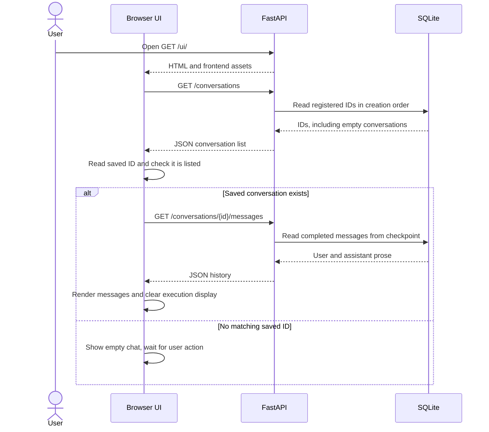
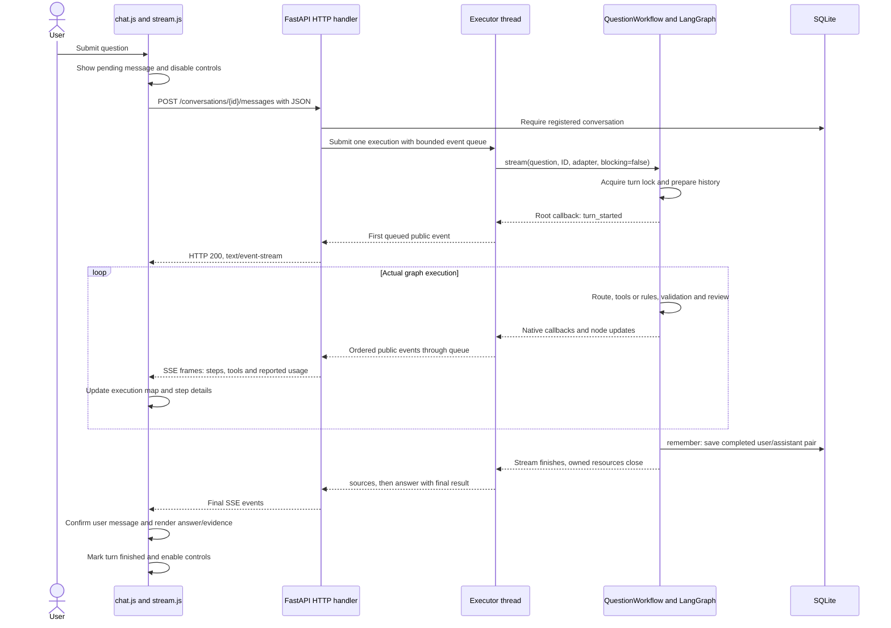
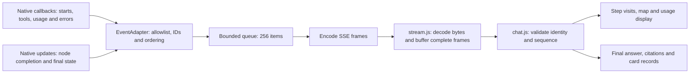
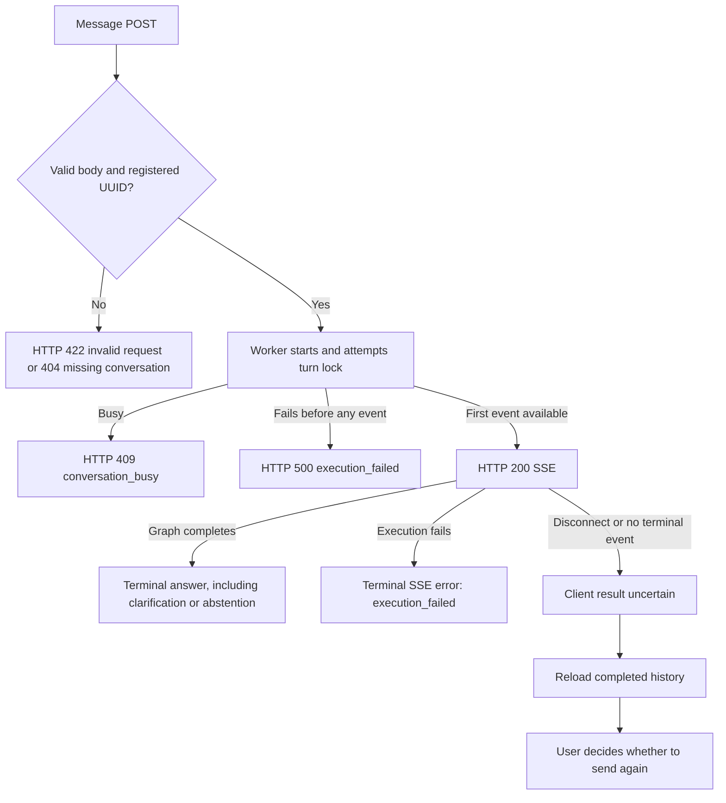

# HTTP and UI lifecycle

Detailed request, event, concurrency and recovery behavior. Start with the
[architecture](../architecture.md#application-boundaries) for system boundaries.

## API responsibilities and request types

The API manages conversations, validates incoming prose, starts one graph execution
per accepted message, and exposes its progress/result through a small public
contract. Graph nodes retain responsibility for routing, tools and answer review.
The API does not implement a second agent or regenerate an answer for the UI.

| Request | Purpose | Response and model activity |
| --- | --- | --- |
| `GET /ui/` and its assets | Load the browser application. | HTML, CSS and JavaScript; no graph execution. |
| `GET /conversations` | Populate the conversation selector. | JSON array of registered IDs, including empty conversations; no model calls. |
| `POST /conversations` | Allocate and register a conversation. | HTTP 201 with a new UUID; no message or model call. |
| `GET /conversations/{id}/messages` | Load completed chat history. | JSON with ID and ordered role/content messages; no graph execution. |
| `POST /conversations/{id}/messages` | Execute a new user turn. | HTTP 200 SSE stream once execution starts, or an HTTP error before streaming. |
| `GET /health`, `GET /version` | Inspect HTTP liveness and package version. | Small JSON responses; no model/index readiness check. |
| `GET /docs`, `GET /openapi.json` | Inspect the API contract. | Interactive documentation or OpenAPI JSON. |

The message body is exactly `{"message":"What is first strike?"}`. It must contain
nonblank text of at most 16,000 characters; extra fields are rejected. The client
cannot submit model names, tool arguments or graph configuration. URLs require a
valid UUID registered through the HTTP API. CLI conversation IDs do not appear in
the HTTP selector automatically, even though both interfaces can use SQLite.

The complete schemas and event vocabulary are in [HTTP API](http-api.md). The
following sections explain how the application uses that contract in practice.

## Opening the UI and selecting a conversation

After loading `/ui/`, `chat.js` initializes its controls and calls
`refreshConversations()`. It reads the last selected ID from local storage only
after fetching the server's list. If that ID still exists, it fetches its history;
otherwise it opens an empty view without executing the agent.

**New conversation** explicitly sends `POST /conversations`, refreshes the list,
and loads the new empty history. Selecting an existing ID sends only a history
GET. **Reload history** refreshes the list and reloads the selected conversation.
These actions do not run tools, retrieval or a model. Controls are disabled while
a turn or control request is active to avoid overlapping UI operations.

If the user sends a message from the empty view, the UI creates a conversation
first, saves its ID, refreshes the selector and then submits the message. Creating
an ID and sending a turn are separate operations; an empty conversation is durable
as soon as its creation request succeeds.

## Sending a message: one request, one execution

`sendMessage()` first checks the local busy flag and message size. It adds the
question to the visible chat as pending, clears the composer and resets the
execution panel to `Connecting`. It then makes one `fetch()` POST containing only
the message. The same response carries all execution events and the final answer.
There is no second progress request, answer request or polling loop.

The HTTP handler waits for the worker's first queue item before committing the
streaming response. This allows a busy-conversation rejection to remain an HTTP
409, and an early execution/setup failure to remain an HTTP 500. The first public
event normally comes from the graph's root-start callback after the turn lock is
acquired and state is prepared. It does not mean the model has already answered.

The worker consumes `QuestionWorkflow.stream()` once. Native callbacks report
starts, tool activity, usage and failures; native graph updates report completed
nodes. After successful iteration, the adapter's accumulated root fields provide
the final prose/cards/citations. `public_answer()` explicitly selects public fields,
then the worker emits `sources` and terminal `answer`. It never calls `answer()`
again to reconstruct the result. Clarification and abstention also produce an
`answer` event: completion means the turn finished, not that a ruling was approved.

## How streaming becomes a live UI

SSE is a sequence of text frames inside the response to the message POST. It is
server-to-client progress on a normal HTTP connection, not a WebSocket. The UI
uses streaming `fetch()` because the browser's `EventSource` interface issues GET
requests and cannot express this JSON POST contract.

Each frame has an `id`, an `event` type and one JSON `data` line, followed by a
blank line. The JSON always contains `conversation_id`, `turn_id` and a sequence
number. Network chunks are not event boundaries: a chunk can contain half a UTF-8
character, part of a JSON frame or multiple frames. `readEvents()` incrementally
decodes UTF-8, buffers incomplete text and dispatches only complete parsed frames.

`receiveEvent()` verifies that events belong to the selected conversation and
current turn. It ignores duplicate/older sequence numbers and rejects gaps. Each
node occurrence has an opaque `step_id`; names alone cannot correlate starts and
completions because `review`, `validate` and card nodes can run more than once.
The adapter serializes callback notifications under a lock, including parallel
tool callbacks, to produce a single ordered public sequence.

| Event | Effect in the browser |
| --- | --- |
| `turn_started` | Change the current turn from connecting to running. |
| `step_started`, `step_completed` | Create/update a specific step visit and duration. |
| `tool` | Attach actual tool start/completion/failure to its step. |
| `model_usage` | Attach reported token counts to a call/step and update the partial total. |
| `sources` | Populate the final source display. |
| `answer` | Confirm the pending question, append the assistant result and finish the turn. |
| `error` | Mark a failed step; terminal `execution_failed` fails the turn. |

The map in `workflow.js` has a fixed topology matching `build_graph()` and
`build_card_graph()`. Events change its observed visits/status; the browser does
not decide which node executes next. Parent `cards` and its child steps are tracked
separately, preserving tool loops and repeated reviews. Selecting a node filters
its visit details; expanding the card graph is presentation state and sends no
HTTP request. Stable buttons preserve keyboard focus and map scroll positions.

Turn duration is wall time, not the sum of overlapping parent/child durations.
Token totals sum only reported per-model totals and may be partial. Missing usage
is displayed as unavailable, rather than inferred as zero. The stream reports
execution progress, not individual answer tokens or private model reasoning.

`PublicEvent` and `PublicAnswer` form a deliberate boundary: raw graph state,
provider messages, prompts, tool arguments and internal review text are not sent
to the UI. User/model/source strings are rendered through DOM `textContent`.
Detailed tracing remains a separate optional backend concern.

## Worker isolation, persistence and concurrent requests

The graph and external clients are synchronous. Running their iterator directly
inside the async HTTP handler would block unrelated HTTP work. Instead, the app
owns a thread executor configured by the process environment variable
`MAGIC_BOT_MAX_WORKERS` (default 8; Render image 1); each turn runs in one worker while the
ASGI loop consumes its queue asynchronously. Ordinary synchronous listing/history
handlers can also run without waiting for that graph's model request.

Every turn has its own workflow resources, event adapter, stop signal and bounded
queue. The queue limits buffered events for a slow consumer and applies backpressure
to the producer. It is in-process communication, not an external job broker or a
durable event log. The configured executor threads bound active turns, not the total number
of HTTP requests waiting for execution capacity; no global admission limit or
end-to-end deadline is implemented.

A process-local lock covers loading history and the whole execution of one
conversation. Another message to that ID fails with 409 instead of waiting;
different IDs can execute independently, subject to executor capacity. Deploy
one server worker: this lock does not coordinate separate Python processes.

SQLite's `api_conversations` table registers HTTP IDs. The LangGraph checkpointer
in the same database stores graph checkpoints and completed messages. The API
history reader extracts completed `human`/`ai` messages from the checkpoint rather
than maintaining a duplicate chat-message store. `remember` appends a complete
pair on terminal routes. Intermediate checkpoints can survive a failed turn, but
are not exposed as partially completed chat history.

A history GET returns role/content only. It does not replay structured citations,
card records, token usage, map visits or SSE events. Reloading history therefore
clears the execution map. The UI can retain an unmatched pending message in memory
while reconciling the same conversation's fetched history; a full page reload or
conversation switch does not preserve that local-only message.

## Errors, disconnects and recovery

Errors before the SSE response starts use normal HTTP status/JSON. Once headers
have been sent, the connection remains HTTP 200 and failures must be represented
by an SSE event or detected as an incomplete stream.

The frontend preserves observed steps, marks unfinished steps interrupted and
restores the submitted text to the composer on failure. It does not automatically
resend the POST. A lost connection may occur after `remember` has stored the turn
but before the terminal answer reaches the browser. Retrying without checking
history could duplicate messages and model charges; no idempotency key or event
replay is available. GET history reconciles completion but cannot reconstruct the
lost execution display.

A disconnect signals the worker's stop event. Queue operations, callbacks and
iteration cooperate with it; the iterator closes in its owning thread, releasing
the catalogue client, SQLite connection and conversation lock. Python cannot
forcibly interrupt an in-flight synchronous model/HTTP call, so cleanup may wait
for that call to return or time out. Server shutdown signals active consumers
and waits for workers as well. An explicit later question starts a fresh turn
with reset transient evidence rather than resuming an interrupted graph node.

There are no SSE heartbeats, reconnection replay, `Last-Event-ID` handling or durable
background jobs. The local API also has no authentication or ownership checks;
conversation UUIDs are identifiers, not authorization credentials. Public access
would require authentication and ownership checks; multiple processes would also
require coordinated conversation locking.
