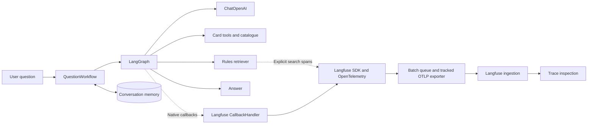
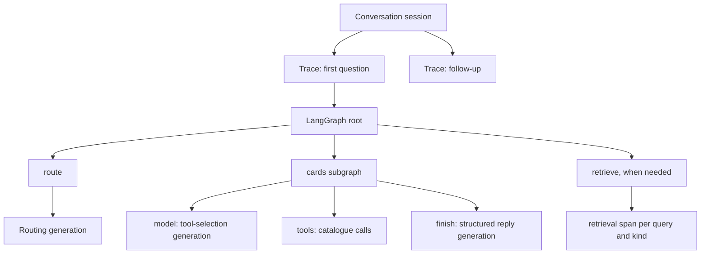

# Observability: Langfuse and Magic Bot tracing

This guide follows a question from graph execution to trace inspection. Function
and node names match the repository. Different routes execute different steps:
a card search, a rules answer and a clarification do not have identical traces.

## Responsibilities and data flow

Langfuse records execution; it does not route questions, provide the model, retrieve
rules or store chat memory. Prompts remain versioned Markdown in `backend/prompts/`,
and SQLite remains the conversation store. This implementation uses tracing, not
remote prompt management, alerts or a self-hosted Langfuse deployment.

| Component | Responsibility |
| --- | --- |
| Magic Bot | Select operations, retrieve evidence and construct answers. |
| LangGraph | Execute the parent graph and subgraphs with native lifecycle events. |
| LangChain | Supply `ChatOpenAI`, native messages, tools and compatible callbacks. |
| Langfuse SDK | Turn callbacks into related observations and prepare export. |
| OpenTelemetry | Supply spans, context propagation and telemetry export. |
| OTLP/HTTP exporter | Send batches to the Langfuse ingestion endpoint. |
| Langfuse Cloud | Ingest, process and expose observations for inspection. |

A callback receives notifications such as model start/completion. The
[LangChain integration](https://langfuse.com/integrations/frameworks/langchain)
provides `CallbackHandler` for graph, model and tool events. Our custom retriever
adds explicit search spans because it is not a native LangChain retriever.



Dotted edges are telemetry. Model and catalogue requests have their own network
connections; Langfuse is not their proxy. Telemetry errors must not replace an
otherwise produced answer, although flushing can add time at the end of a turn.

## Conversations, sessions and observations

| Concept | Meaning here |
| --- | --- |
| Conversation | Complete user/assistant history stored locally under `conversation_id`. |
| Langfuse session | A grouping of traces using that conversation ID. |
| Turn | One question and the execution attempting to answer it. |
| Trace | Related observations for one turn sharing `trace_id`. |
| Observation | One operation with timing, input/output and parent relationship. |
| Span | OpenTelemetry operation; explicit retrieval is recorded as a span. |
| Generation | Observation of a model call, including usage when reported. |

Native nodes may appear as `CHAIN`, tools as `TOOL`, and model calls as
`GENERATION`. A node's duration includes its children. Additional framework
observations such as `RunnableSequence` may appear between application nodes.



These edges show grouping, not temporal order. Reusing a CLI conversation ID
recovers history only with the same SQLite file. Reusing the Langfuse session ID
with an empty database groups traces but does not recover another database's
messages. `card-chat` does not persist a conversation: `CardAgent.answer()` creates
a fresh UUID session and one trace on each call.

## Code map

| File | Relevant responsibility |
| --- | --- |
| [workflow/cli.py](../../backend/workflow/cli.py) | Arguments, invocation, readable/JSON/event output. |
| [workflow/graph.py](../../backend/workflow/graph.py) | `build_graph()`, `_tracing()`, `answer()` and `stream()`. |
| [workflow/nodes.py](../../backend/workflow/nodes.py) | Workflow steps; `_search()` instruments retrieval. |
| [cards/agent.py](../../backend/cards/agent.py) | Native card graph and standalone `CardAgent.answer()`. |
| [cards/tools.py](../../backend/cards/tools.py) | Typed `search_cards` and `get_card_by_name` tools. |
| [generation/llm.py](../../backend/generation/llm.py) | Structured generation and native tool calls. |
| [common/tracing.py](../../backend/common/tracing.py) | Configuration, callbacks, retrieval spans and export result. |
| [common/prompts.py](../../backend/common/prompts.py) | Prompt loading, version, hash and rendering. |
| [workflow/memory.py](../../backend/workflow/memory.py) | SQLite, turn exclusion and allowed serialized types. |
| [test_tracing.py](../../tests/test_tracing.py) | Correlation and telemetry-failure regression checks. |

## Turn lifecycle and callback propagation

`QuestionWorkflow._tracing(conversation_id)` passes the session ID, `question-turn`
name, model, reasoning effort and optional rules edition to `trace_turn()`.
The following outline omits resource opening, locking and cleanup details:

```python
with self._tracing(conversation_id) as turn:
    try:
        state, config = self._prepare_turn(question, conversation_id)
        result = self.graph.invoke(state, turn.apply(config))
    except Exception as exc:
        turn.fail(exc)
        raise
```

`_prepare_turn()` loads history, resets transient evidence and supplies
`configurable.thread_id` to the checkpointer. `turn.apply(config)` preserves it
and adds callbacks/metadata, including `langfuse_session_id`. Nested LangChain
operations inherit callback context; `LLM.generate()` and `LLM.call_tools()` do
not create separate manual root traces. The graph executes once.

At root completion, `_OutcomeHandler` attaches the turn summary before the
Langfuse callback closes the root. The SDK can export during execution; context
exit flushes pending events and verifies export for the current `trace_id`.
The workflow retains the final report in `workflow.trace_report`.

### Tracing implementation

- `TraceReport`: telemetry `status`, `trace_id` and safe `detail`, separate from
  the answer's approval status.
- `client_from_env()`: load `.env` without overriding process variables, decide
  activation and require both keys when tracing is explicitly requested.
- `_client()`: cache the client/exporter pair with `lru_cache(maxsize=1)` for a
  configuration. The SDK shares project resources; detached per-turn exporters
  would not reliably observe their own exports.
- `_LangfuseClient`: authenticated SDK/exporter configuration, a fresh turn
  `CallbackHandler` in `open()`, and queue flushing.
- `_InactiveTurn`: the same context-manager interface without observations;
  `apply()` returns the original configuration.
- `_ActiveTurn`: callbacks, metadata, summary and first-failure retention through
  `mark_missing()`.
- `_OutcomeHandler`: observe root completion/error without creating a second tree.
- `_LangfuseSession`: callback and metadata for one turn, root `finish()`, retrieval
  observations and `verify_export()`. Despite its class name, this object represents
  one turn; `langfuse_session_id` defines the session visible in Langfuse.
- `_ExportStatus`: track export outcomes per trace without aggregating tokens/prices.
- `warn_missing_trace()`: CLI warning when the final status is `missing`.

`trace_turn()` restores context and flushes in `finally`, including exceptions.
The `_current` `ContextVar` makes the active turn available to `_search()` without
passing it through every function. Its token restores the previous context.
The export tracker's lock has a different purpose: synchronize exporter-thread
writes with the end-of-turn read.

### Root summary

`summarize_turn()` supplements native inputs/outputs with selected root metadata:

| Field | Interpretation |
| --- | --- |
| `question`, `model`, `reasoning_effort` | Question/configuration; missing model settings fall back to turn metadata. |
| `rules_edition`, `source_editions` | Requested filter and editions of retained sources. |
| `prompts` | Used prompt names, versions and SHA-256 hashes. |
| `queries`, `repair_queries` | Initial queries and proposed recovery queries; proposals may not execute. |
| `retrieved_ids` | Final context IDs after deduplication, expansion and budgeting. |
| `tools` | Retained tool names, arguments, call IDs, statuses and error types. |
| `review` | Latest model verdict with the workflow's approval result. |
| `additional_retrievals`, `repairs` | Recovery counters. |
| `reason`, `validation_error`, `error` | Exit reason, validation issue and exception type. |

`_prompt_metadata()` combines `card_prompts` and `prompts`, retaining entries with
version/hash rather than the full available prompt catalogue. The hash identifies
exact loaded bytes; changing a file changes its hash even if its version label
is unchanged. Native callbacks can still retain much more data than this summary.

## Graph routes and retrieval spans

Follow the [architecture diagrams](../architecture.md#answering-one-question) for
routing and recovery. A card search ends after its subgraph, unresolved identities
ask for clarification, and verified interactions proceed to rules retrieval.
Python controls approval, at most one repair and one additional retrieval round.
Current policy also permits local repair when no additional search is needed.
A positive model verdict cannot override invalid citations.

Within `cards`, native `model`, `tools`, `collect` and `finish` events remain
separate. The structured reply under `finish` is another model generation, not
an HTTP operation. Namespaces identify subgraph locations; their run suffixes are
not prompt versions. `parent_observation_id` establishes parentage.

`Retriever.search()` and `get()` are custom methods, so a node callback alone
cannot explain which query yielded which sources. `_search()` adds:

```python
with retrieval_observation(query, kind=kind, edition=self.version) as observed:
    hits = self.retriever.search(query, k=self.k, kind=kind, version=self.version)
    observed.sources(hit.id for hit in hits)
    return hits
```

`_Sources` retains IDs; `retrieval_observation()` measures `time.perf_counter()`
and records query, kind, edition, IDs, error and `latency_ms`. The observation
closes and restores context even if metadata updates fail. Each query searches
rules and glossary separately, so it can create two retrieval spans. Recovery
uses the same `_search()` for searches actually performed.

Search spans contain results **before** context budgeting. Root `retrieved_ids`
contains final evidence after budgeting, deduplication and reference expansion.
Differences are expected. Search duration can include embedding requests and
ranking; these spans do not record embedding tokens or create model generations.
Reference-expansion `get()` calls have no individual search spans; `expand`
provides node-level visibility.

## Durations, tokens and cost

A parent's duration overlaps its children: summing nested spans does not measure
user wait time. CLI wall time can also include resource opening and final flush
outside the graph root. Retrieval's `latency_ms` measures the search call.

Native generations retain provider usage when available. Input includes prompts,
history and evidence. Output accounting may contain provider-reported reasoning
categories; this does not imply readable private reasoning is exposed. Inspect
reported totals and categories without adding totals to their components.
Missing usage is unknown, not zero.

Application code does not write duplicate usage onto `cards` or `LangGraph`.
If two generations report 100 and 200 tokens, their sum is 300; adding an aggregated
parent total would double count. Prices require applicable model rates, cache and
reasoning accounting. Magic Bot does not maintain a parallel price table or write
unknown cost as zero. Langfuse may estimate cost when it recognizes the model.
A callback's zero cost on a failed observation without usage is not a reliable
cost measurement.

## Export and failures

The SDK batches observations instead of making one HTTP request per node. Context
exit calls `flush()` so short scripts do not exit with pending events.
`_LangfuseClient` uses the public
[`span_exporter` configuration](https://python.reference.langfuse.com/langfuse)
with an authenticated `OTLPSpanExporter`, a five-second timeout and
`<LANGFUSE_BASE_URL>/api/public/otel/v1/traces`. HTTP Basic uses project keys;
Base64 is encoding, while HTTPS protects transport. The
`x-langfuse-ingestion-version: 4` header selects the ingestion path. The standard
exporter owns transport and retry behavior.

A flush without an exception does **not** establish export success: OpenTelemetry
may return `SpanExportResult.FAILURE`. `_ExportStatus.export()` records success
or failure for each trace in a batch. A trace can span batches; later success does
not erase an earlier failure. Exceptions also count as failed exports.

The lock synchronizes exporter writes and verification reads. `consume()` removes
the consulted result; tracking is bounded to 1,024 recent traces. An evicted or
unavailable result is unconfirmed, never an invented success. After flush,
`verify_export()` requires positive evidence for this trace; it neither creates
extra spans nor polls the Langfuse API per answer.

| Final status | Meaning |
| --- | --- |
| `disabled` | Tracing was not requested or configuration explicitly disabled it. |
| `recorded` | Successful export was observed without detected telemetry failures. |
| `missing` | Tracing was requested, but an operation failed or export was unconfirmed. |

Inspect `trace_report` after `answer()` finishes or the stream iterator closes.
`recorded` does not guarantee immediate UI visibility, complete instrumentation
or semantic correctness. Functional model/index errors still propagate; telemetry
failure handling does not turn them into valid answers. Existing structured-output
abstention policies remain the responsibility of graph nodes.

The first safe telemetry failure is retained. A successful answer can accompany:

```text
Trace unavailable (Langfuse export failed or unconfirmed). The answer was still produced.
```

## Configuration and demonstration

Obtain both keys from a Langfuse project you can access. They authenticate telemetry
and do not provide model access. Keep actual values in Git-ignored `.env`:

```dotenv
LANGFUSE_PUBLIC_KEY=<project public key>
LANGFUSE_SECRET_KEY=<project secret key>
LANGFUSE_BASE_URL=https://cloud.langfuse.com
LANGFUSE_TRACING_ENABLED=true
```

Use the base URL for the project's region or your instance; the example is Cloud
EU. See the [integration setup](https://langfuse.com/integrations/frameworks/langchain).
This repository does not deploy Langfuse itself.

- `LANGFUSE_TRACING_ENABLED=false` disables tracing even with keys.
- Both keys with an unset flag or `true` enable tracing.
- Without both keys and without explicit activation, tracing stays disabled.
- Explicit activation with incomplete keys yields `missing`; otherwise functioning
  model/index dependencies can still produce an answer.

Equivalent flag values include `0/no/off` and `1/yes/on`, case-insensitively.
Process environment overrides `.env`. Restart after changing credentials; cached
SDK resources are not hot-reloaded.

```sh
uv run --locked magic-chat --conversation-id langfuse-demo 'Find Lightning Bolt.'
uv run --locked magic-chat --conversation-id langfuse-demo \
  'Can it target a creature with protection from red?'
uv run --locked magic-chat --conversation-id langfuse-demo \
  'Find white Warrior creatures with mana value less than two.'
```

These commands use real services and the same default SQLite history. Find
`langfuse-demo` in Sessions; each question adds one trace.

## Data leaving the machine

Enabled native callbacks may send node input/output, question, selected history,
rendered prompts, answers, tool arguments/results and rules text. Model messages
may contain encrypted provider reasoning state used to continue native tool loops.
API keys are not added to the root summary, but this is not automatic anonymization:
a native callback may retain original exception text even though our summary
reduces errors to their type. Consider executed content when sharing a project.
Disabled tracing stops Langfuse telemetry, not functional model/catalogue requests.

| Output | Purpose |
| --- | --- |
| Langfuse | Detailed internal execution inspection. |
| `state["trace"]` | Local `_traced()` debug list of nodes, fields, queries and sources. |
| `card-chat --trace` | Console tool arguments, call IDs and statuses. |
| `magic-chat --events` | Conversation ID, namespaces and completed node names. |
| HTTP/SSE | Allowlisted public execution events and final results. |

`--trace` does not enable Langfuse. `--events` does not rerun the graph or emit raw
messages. `--json` is full internal diagnostic state and is not the public HTTP
contract; the frontend receives only the [HTTP API](http-api.md) allowlist.

## Inspecting a trace

1. Find the session by conversation ID and open the question's trace.
2. Inspect the `LangGraph` root's question, model, source editions and turn metadata.
3. Open `route` for classification and the resolved question.
4. Expand `cards` and compare tool arguments, status, call IDs and namespaces
   with `turn.tools`. Inspect `model` and `finish` generations separately.
5. For rules, compare retrieval query/kind/IDs with `turn.retrieved_ids` and `expand`.
6. Inspect evidence and objections in `generate`, `review` and optional `repair`.
7. Compare per-generation duration and usage without adding parent totals.
8. Check the terminal outcome: approved answer, clarification, abstention or error.

SDK v5 can flatten metadata into names such as `turn.prompts.route.version`,
`turn.prompts.route.sha256`, `turn.retrieved_ids` and `turn.review.approved`.
Framework helper nodes can add intermediate observations.

| Symptom | Check |
| --- | --- |
| No trace | Both keys, activation flag, region and CLI warnings. |
| `missing Langfuse keys` | Explicit activation without both process-visible keys. |
| Export failed/unconfirmed | Endpoint reachability, credentials, region and sampling. |
| `recorded` but not visible | Ingestion delay, project, session and date/environment filters. |
| Missing node | The route may not execute it; clarification needs no rules search. |
| No usage on `cards` | Inspect child generations; parents have no separate usage. |
| Search IDs differ from context | Budgeting, deduplication, references and recovery searches. |
| Follow-up history missing | Use the same ID and SQLite file; Langfuse sessions do not restore memory. |

## Verification and limits

Deterministic tracing checks live in `tests/test_tracing.py`. They cover
correlation, metadata, configuration and export failures without losing answers.
See [the README](../../README.md#tests-and-evaluation) for the test command and [evaluation results](../evaluation.md)
for the delivery evidence and pending visual inspection. Earlier live measurements
and API inspection notes are in [observability validation](../experiments/observability-validation.md).

## Streaming lifecycle

`QuestionWorkflow.stream()` uses the same `trace_turn()` as `answer()`, invoking
`graph.stream(..., stream_mode="updates", subgraphs=True)`. Updates and callbacks
come from one execution and the same trace. Exhaust the iterator or close it when
abandoning consumption so `finally` releases resources and flushes. Exporting a
partial trace does not complete the turn. Start a new question in the same
conversation to continue after interruption.
