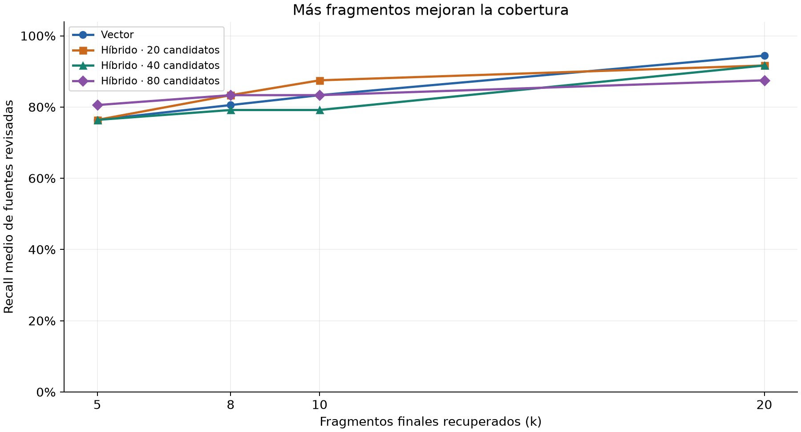
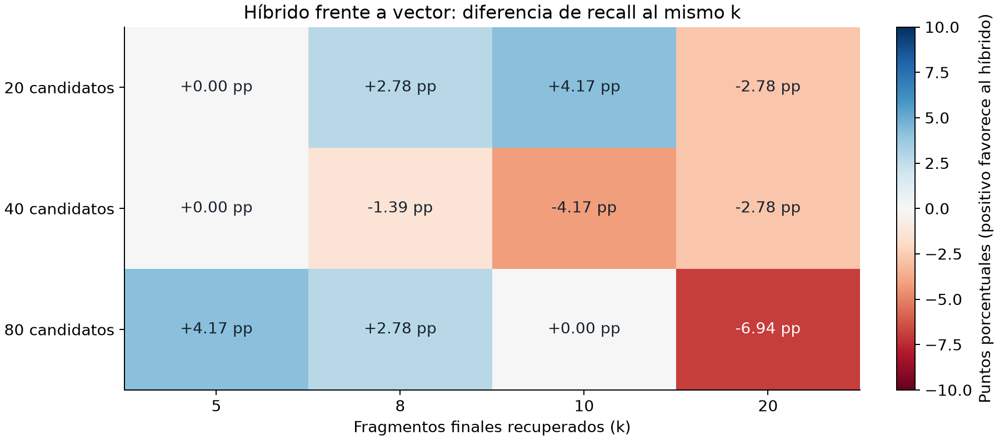
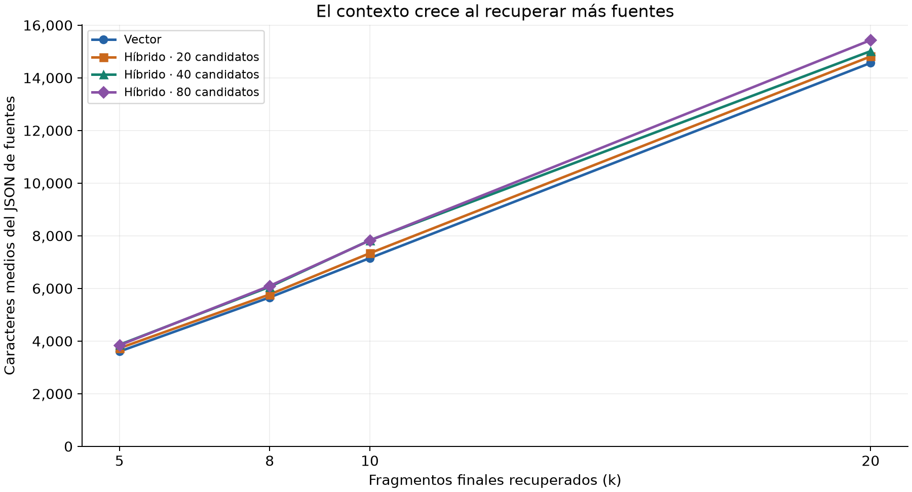
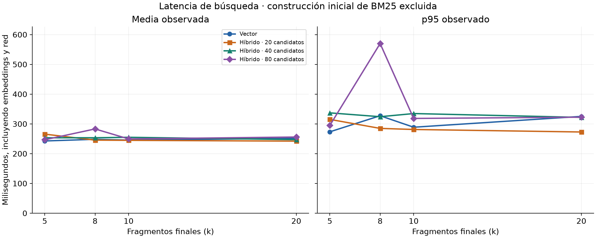
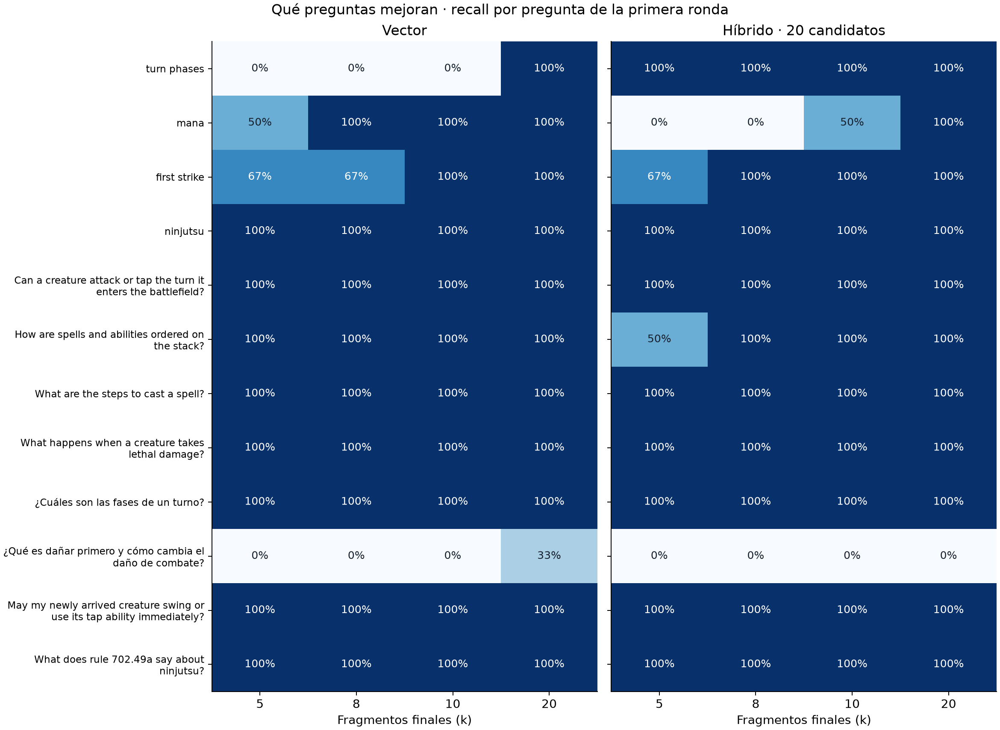

# Cantidad de fragmentos y candidatos: experimento de recuperación

Este experimento amplía la comparación inicial sin cambiar el corpus, sus
fragmentos ni las fuentes relevantes revisadas. Estudia cuántos fragmentos
recuperar y cuántos candidatos fusionar; no evalúa respuestas generadas.

## Diseño reproducible

- 4.020 documentos de April 17, 2026; las mismas 12 preguntas y juicios previos.
- Chroma con text-embedding-3-small, 1.536 dimensiones; BM25 y RRF sin cambios.
- k=5,8,10,20 para vector y para híbrido con 20,40,80 candidatos por rama:
  16 configuraciones. Los candidatos no son el número final de fuentes.
- Tres rondas completas: 576 búsquedas con solicitudes reales de embeddings,
  sin caché de consultas. Cada búsqueda conserva sus IDs y medidas.
- Orden de configuraciones barajado con semilla 42 en cada ronda. Se mantiene
  el orden de las 12 preguntas dentro de cada configuración.
- Validación y construcción inicial de BM25 medidas aparte: 422.85 ms.
  Las latencias de búsqueda incluyen embeddings, red, consulta, ranking y
  materialización de fuentes, pero excluyen esa construcción inicial.
- No se modifica la colección, el algoritmo ni los valores predeterminados.

El fichero [parameter-sweep.json](../data/retrieval/parameter-sweep.json) conserva
el orden de ejecución, configuración, fuentes y candidatos completos de la primera
ronda y los resultados/medidas de las tres rondas. La visualización portátil está
en [parameter-sweep.html](../data/retrieval/parameter-sweep.html).

```sh
uv run --locked benchmark-retrieval --sweep --repeats 3 --output data/retrieval/parameter-sweep-local.json
uv run --locked python -m unittest discover -s tests -v
```

En modo sweep, la matriz fija sustituye a `-k`, `--method` y `--candidate-limit`.
Se pueden seleccionar otros corpus mediante las opciones existentes.

## Cómo leer las métricas

- Recall medio: fracción de fuentes revisadas encontradas, promediada por pregunta.
  Las preguntas con tres fuentes pesan lo mismo que aquellas con una.
- Alguna fuente (hit rate): proporción de preguntas con al menos un acierto revisado.
- Todas las fuentes (full recall): proporción que recupera todos sus IDs revisados.
- MRR: media de `1/posición del primer acierto`, o cero si no hay ninguno.
  Permite distinguir obtener más documentos de colocar pronto una fuente útil.
- Contexto: longitud del JSON de los SearchResult completos, con referencias y
  procedencia; no son tokens. También se conserva longitud de título/cuerpo.
- Latencia: media, p50 y p95 observados, sin interpolación (rango más próximo).
  Cada fila resume 36 búsquedas (12 preguntas × 3 rondas).
- >24.000: búsquedas cuyo array bruto supera esos caracteres; no simula el workflow,
  que busca por tipo, puede usar varias consultas, añade cartas y referencias y
  recorta según su presupuesto. Los límites pueden descartar fuentes recuperadas.

No se calcula precisión: los juicios son incompletos y una fuente no revisada no
se considera automáticamente irrelevante.

## Calidad de recuperación



Más alto significa encontrar una mayor proporción de las fuentes revisadas.
Todas las curvas usan las tres rondas y el mismo banco. Las líneas conectan
únicamente las configuraciones medidas: no se han probado los valores intermedios.



Cada celda compara el híbrido con vector al mismo número de resultados finales.
**Positivo favorece al híbrido; negativo favorece a vector.** La unidad son puntos
porcentuales, no porcentaje de mejora relativa. Así se aprecia que aumentar
candidatos no produce una mejora uniforme.

| Método | k | Candidatos/rama | Recall medio | Alguna fuente | Todas las fuentes | MRR |
|---|---:|---:|---:|---:|---:|---:|
| vector | 5 | — | 76.39% | 83.33% | 66.67% | 0.5028 |
| hybrid | 5 | 20 | 76.39% | 83.33% | 66.67% | 0.5556 |
| hybrid | 5 | 40 | 76.39% | 83.33% | 66.67% | 0.5556 |
| hybrid | 5 | 80 | 80.56% | 91.67% | 66.67% | 0.5722 |
| vector | 8 | — | 80.56% | 83.33% | 75.00% | 0.5028 |
| hybrid | 8 | 20 | 83.33% | 83.33% | 83.33% | 0.5556 |
| hybrid | 8 | 40 | 79.17% | 83.33% | 75.00% | 0.5556 |
| hybrid | 8 | 80 | 83.33% | 91.67% | 75.00% | 0.5722 |
| vector | 10 | — | 83.33% | 83.33% | 83.33% | 0.5028 |
| hybrid | 10 | 20 | 87.50% | 91.67% | 83.33% | 0.5639 |
| hybrid | 10 | 40 | 79.17% | 83.33% | 75.00% | 0.5556 |
| hybrid | 10 | 80 | 83.33% | 91.67% | 75.00% | 0.5722 |
| vector | 20 | — | 94.44% | 100.00% | 91.67% | 0.5144 |
| hybrid | 20 | 20 | 91.67% | 91.67% | 91.67% | 0.5639 |
| hybrid | 20 | 40 | 91.67% | 91.67% | 91.67% | 0.5625 |
| hybrid | 20 | 80 | 87.50% | 91.67% | 83.33% | 0.5722 |

## Latencia y contexto



El tamaño corresponde al JSON completo de fuentes recuperadas, antes de ampliar
referencias o aplicar el presupuesto del workflow. No representa tokens ni el
coste final de generación.



Media y p95 comparten escala para que sus diferencias sean comparables. Incluyen
embeddings y red, y excluyen la construcción inicial de BM25. El pico de p95
es una observación de estas muestras, no una garantía ni una diferencia causal
atribuible al algoritmo.

| Método | k | Candidatos/rama | Media ms | p50 ms | p95 ms | Contexto medio caracteres | Máximo | >24.000 |
|---|---:|---:|---:|---:|---:|---:|---:|---:|
| vector | 5 | — | 242.64 | 242.98 | 273.36 | 3604 | 5267 | 0/36 |
| hybrid | 5 | 20 | 265.61 | 246.38 | 315.11 | 3731 | 7439 | 0/36 |
| hybrid | 5 | 40 | 253.28 | 246.33 | 337.03 | 3862 | 7439 | 0/36 |
| hybrid | 5 | 80 | 246.70 | 240.51 | 294.72 | 3844 | 7439 | 0/36 |
| vector | 8 | — | 248.21 | 236.33 | 327.34 | 5660 | 8325 | 0/36 |
| hybrid | 8 | 20 | 245.43 | 242.87 | 284.88 | 5772 | 8985 | 0/36 |
| hybrid | 8 | 40 | 253.41 | 252.92 | 324.13 | 6062 | 9053 | 0/36 |
| hybrid | 8 | 80 | 283.04 | 252.65 | 569.94 | 6097 | 9053 | 0/36 |
| vector | 10 | — | 245.51 | 242.32 | 288.80 | 7153 | 9979 | 0/36 |
| hybrid | 10 | 20 | 244.75 | 241.81 | 281.24 | 7339 | 10891 | 0/36 |
| hybrid | 10 | 40 | 254.96 | 242.79 | 334.71 | 7831 | 11960 | 0/36 |
| hybrid | 10 | 80 | 249.48 | 246.30 | 318.32 | 7823 | 11874 | 0/36 |
| vector | 20 | — | 251.52 | 241.44 | 325.20 | 14568 | 20511 | 0/36 |
| hybrid | 20 | 20 | 242.08 | 240.13 | 272.77 | 14814 | 21177 | 0/36 |
| hybrid | 20 | 40 | 247.11 | 243.74 | 321.86 | 15015 | 20458 | 0/36 |
| hybrid | 20 | 80 | 255.88 | 250.71 | 322.54 | 15433 | 22104 | 0/36 |

## Evolución por pregunta



Cada celda muestra la fracción de fuentes revisadas recuperadas para esa pregunta.
El azul más intenso representa mayor cobertura. Este gráfico utiliza la primera
ronda; las métricas de relevancia fueron iguales en las tres. La tabla siguiente
añade la comparación con 80 candidatos híbridos.

Cada celda muestra recall para k=5 / 8 / 10 / 20 de la primera ronda. Los IDs y
posiciones exactos están en el JSON; no se modifican los juicios tras observarlos.

| Pregunta | Vector k=5/8/10/20 | Híbrido c20 k=5/8/10/20 | Híbrido c80 k=5/8/10/20 |
|---|---|---|---|
| turn phases | 0% / 0% / 0% / 100% | 100% / 100% / 100% / 100% | 100% / 100% / 100% / 100% |
| mana | 50% / 100% / 100% / 100% | 0% / 0% / 50% / 100% | 50% / 50% / 50% / 100% |
| first strike | 67% / 67% / 100% / 100% | 67% / 100% / 100% / 100% | 67% / 100% / 100% / 100% |
| ninjutsu | 100% / 100% / 100% / 100% | 100% / 100% / 100% / 100% | 100% / 100% / 100% / 100% |
| Can a creature attack or tap the turn it enters the battlefield? | 100% / 100% / 100% / 100% | 100% / 100% / 100% / 100% | 100% / 100% / 100% / 100% |
| How are spells and abilities ordered on the stack? | 100% / 100% / 100% / 100% | 50% / 100% / 100% / 100% | 50% / 50% / 50% / 50% |
| What are the steps to cast a spell? | 100% / 100% / 100% / 100% | 100% / 100% / 100% / 100% | 100% / 100% / 100% / 100% |
| What happens when a creature takes lethal damage? | 100% / 100% / 100% / 100% | 100% / 100% / 100% / 100% | 100% / 100% / 100% / 100% |
| ¿Cuáles son las fases de un turno? | 100% / 100% / 100% / 100% | 100% / 100% / 100% / 100% | 100% / 100% / 100% / 100% |
| ¿Qué es dañar primero y cómo cambia el daño de combate? | 0% / 0% / 0% / 33% | 0% / 0% / 0% / 0% | 0% / 0% / 0% / 0% |
| May my newly arrived creature swing or use its tap ability immediately? | 100% / 100% / 100% / 100% | 100% / 100% / 100% / 100% | 100% / 100% / 100% / 100% |
| What does rule 702.49a say about ninjutsu? | 100% / 100% / 100% / 100% | 100% / 100% / 100% / 100% | 100% / 100% / 100% / 100% |

## Interpretación y límites

**Sí, aumentar los resultados finales mejora la recuperación en este banco.**
Vector pasa de 76,39% con k=5 a 80,56%, 83,33% y 94,44% con k=8,10,20.
Su contexto medio crece de 3.604 a 14.568 caracteres: 4,04 veces más para ganar
18,06 puntos de recall. Ningún array bruto supera 24.000 caracteres en este
experimento; el máximo global es 22.104. Esto no garantiza cabida en el workflow,
que puede reunir varios arrays y expandir referencias.

La explicación se ve en fuentes concretas:

- `106.1` para `mana` está en el puesto vectorial 6: aparece al pasar de k=5 a 8.
- `702.7b` para `first strike` está en el puesto vectorial 10: hace falta k=10.
  En híbrido c20 queda en el puesto 7 y aparece con k=8.
- `500.1` para `turn phases` está en el puesto vectorial 13: aparece con k=20.
  El híbrido ya la recupera con k=5.
- En español, la pregunta sobre dañar primero solo recupera `702.7b`, en el
  puesto vectorial 16: recall 1/3 con k=20. Todos los híbridos siguen en cero.
  Ambos métodos con k=20/c20 recuperan todas las fuentes revisadas de las diez
  preguntas inglesas; su diferencia media final proviene de ese acierto español.

**Ampliar los candidatos híbridos no asegura mejorar.** Con k=10, c20 obtiene
87,50%, c40 baja a 79,17% y c80 a 83,33%. El aumento altera el ranking de RRF:
los candidatos nuevos pueden recibir una segunda contribución y adelantar a
fuentes que solo coinciden en una rama. Por ejemplo, `405.1` en la pregunta de
la pila mantiene el puesto vectorial 2 y la misma puntuación RRF, pero pasa del
puesto fusionado 6 (c20) al 33 (c80), quedando fuera incluso de k=20.
Con k=5, c80 sí mejora el promedio a 80,56%, pero sigue perdiendo parte de la
respuesta revisada de la pila respecto a vector; no hay ganador universal.

**Compromisos observados, sin cambiar los valores predeterminados:**

- Vector k=20 logra el máximo recall de la matriz: 94,44%, contexto medio 14.568.
- Híbrido k=10/c20 obtiene 87,50% con 7.339 caracteres medios, aproximadamente
  la mitad del contexto de vector k=20. Su MRR es 0,5639 frente a 0,5144:
  coloca antes el primer acierto, aunque encuentra menos fuentes en total.
- Híbrido k=8/c20 obtiene 83,33%, con 5.772 caracteres medios. Es comparable
  al recall de vector k=10 (83,33%) con menos contexto, pero no recupera las
  mismas fuentes: sigue fallando completamente en `mana`.
- El máximo MRR medido es 0,5722 en híbrido c80, pero no coincide con el
  máximo recall. El primer acierto y la cobertura completa son objetivos distintos.

La latencia media queda entre 242 y 283 ms en las configuraciones medidas.
No aumenta cuatro veces cuando k aumenta cuatro veces, porque la solicitud
pequeña de embedding y su viaje de red siguen dominando buena parte del tiempo.
No hemos instrumentado cada fase para atribuirle un porcentaje exacto. Esto no
incluye el coste de enviar más contexto a un modelo generador: ese coste puede
crecer aunque la búsqueda tarde parecido. Los p95 observados llegan a 569,94 ms;
no deben interpretarse como una garantía de producción ni prueba estadística de
que un método sea más rápido. La construcción inicial del índice léxico tardó
422,85 ms y se publica separada del tiempo de búsquedas.

Las métricas de relevancia se mantuvieron iguales entre las tres rondas. Hubo
solo dos cambios del orden/lista respecto a la primera ronda, ambos con c40,
sin cambiar el recall o el primer acierto. Chroma es aproximado y los embeddings
pueden mostrar pequeñas diferencias numéricas; no se atribuye aquí una causa
concreta a esos dos cambios sin instrumentación adicional.

**Conclusión de alcance:** k=5 no era una exploración suficiente. La matriz
muestra una mejora clara al recuperar más fuentes y compromisos interesantes
con híbrido, pero no justifica imponer un único método para todas las preguntas.
Se conserva el valor predeterminado existente y se documentan las alternativas.
El criterio inicial de promoción era para k=5: ninguna configuración nueva de
k=5 elimina las regresiones individuales. Los resultados de k mayores son
exploratorios, no una redefinición retroactiva de ese criterio.

No se han cambiado los fragmentos del parser, traducido las consultas españolas,
ajustado los juicios ni evaluado respuestas generadas. Antes de escoger un k de
producción habría que medir las fuentes que realmente sobreviven al presupuesto
del workflow y la calidad/coste de sus respuestas. El banco pequeño, con dos
preguntas españolas y preguntas relacionadas, no permite generalizar a todo el
reglamento ni a consultas reales de usuarios.


## Regenerar las gráficas

Las cinco imágenes PNG están en `docs/images/retrieval/` y se insertan con rutas
relativas para que el informe se pueda revisar en un visor Markdown normal.
Se generan directamente desde el JSON guardado, sin nuevas llamadas a modelos:

```sh
uv run --locked --with matplotlib python -m evals.plot_retrieval
```

El script `evals/plot_retrieval.py` también acepta `--input` y `--output`.
Matplotlib se proporciona solo al comando de documentación; no se añade a las
dependencias de la aplicación. Para graficar otro experimento, primero ejecuta
el sweep y después selecciona su JSON mediante `--input`.
